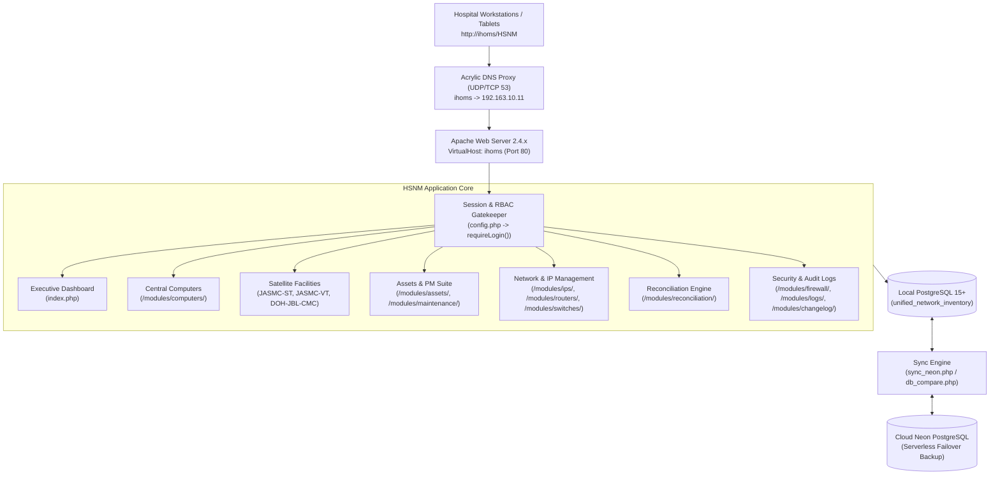
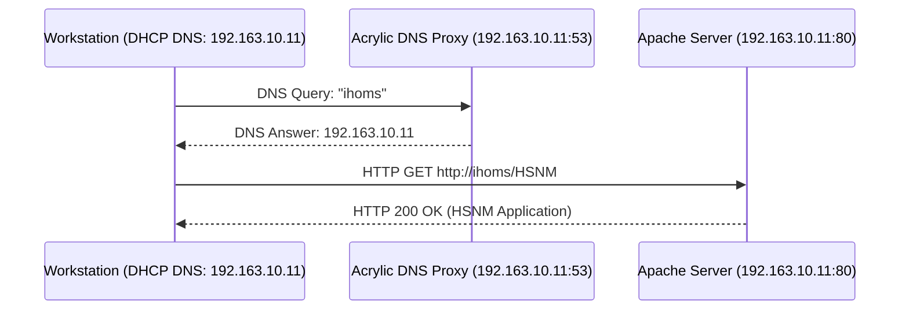

# Hardware & Security Network Management (HSNM)
## Comprehensive System Technical Documentation & Manual
**Version:** v1.15.4  
**Last Updated:** October 28, 2026  
**Primary Maintainer / Author:** IHOMS-MIKE  
**Target Environment:** Local Intranet (`http://ihoms/HSNM` / `192.163.10.11`) & Neon Cloud Failover

---

## Table of Contents
1. [System Overview & Architecture](#1-system-overview--architecture)
2. [Technical Stack & Environment Setup](#2-technical-stack--environment-setup)
3. [Directory Layout & File Structure](#3-directory-layout--file-structure)
4. [Security, Authentication & Role-Based Access Control (RBAC)](#4-security-authentication--role-based-access-control-rbac)
5. [Core Functional Modules](#5-core-functional-modules)
   - [5.1 Central Computer Inventory (`/modules/computers/`)](#51-central-computer-inventory-modulescomputers)
   - [5.2 Multi-Facility Satellite Modules (`jasmc_st`, `jasmc_vt`, `doh_jbl_cmc`)](#52-multi-facility-satellite-modules-jasmc_st-jasmc_vt-doh_jbl_cmc)
   - [5.3 Asset Inventory (`/modules/assets/`)](#53-asset-inventory-modulesassets)
   - [5.4 Preventive Maintenance (PM) Suite (`/modules/maintenance/`)](#54-preventive-maintenance-pm-suite-modulesmaintenance)
   - [5.5 IP Address Management (`/modules/ips/`)](#55-ip-address-management-modulesips)
   - [5.6 Reconciliation Engine (`/modules/reconciliation/`)](#56-reconciliation-engine-modulesreconciliation)
   - [5.7 Network Hardware: Routers & Switches (`/modules/routers/`, `/modules/switches/`)](#57-network-hardware-routers--switches-modulesrouters-modulesswitches)
   - [5.8 Microsoft Office Licenses (`/modules/office/`)](#58-microsoft-office-licenses-modulesoffice)
   - [5.9 Peripherals & Auxiliary Modules](#59-peripherals--auxiliary-modules)
   - [5.10 Audit Logs, Changelog & System Settings](#510-audit-logs-changelog--system-settings)
6. [Complete Database Schema & Data Dictionary](#6-complete-database-schema--data-dictionary)
7. [Network Topology, DNS Proxy & VirtualHost Setup](#7-network-topology-dns-proxy--virtualhost-setup)
8. [Database Cloud Synchronization & Disaster Recovery](#8-database-cloud-synchronization--disaster-recovery)
9. [Chronological Revision History (v1.0.0 – v1.15.4)](#9-chronological-revision-history-v100--v1154)
10. [System Administration & Operational Runbook](#10-system-administration--operational-runbook)

---

## 1. System Overview & Architecture

**Hardware & Security Network Management (HSNM)** is an enterprise healthcare IT infrastructure, network operations, and asset lifecycle platform designed for hospitals and regional health facilities. Built to replace scattered spreadsheets and disconnected tools, HSNM unifies physical hardware tracking, satellite facility inventories, IP address allocation, network diagnostic polling, software compliance, and preventive maintenance audits.



---

## 2. Technical Stack & Environment Setup

| Layer | Technology | Version / Configuration |
|---|---|---|
| **Operating System** | Windows Server / Windows 10/11 Pro | Local LAN IP configured via `LOCAL_HOST_IP` |
| **Web Server** | Apache HTTP Server (XAMPP) | v2.4.x with `mod_rewrite`, `mod_env`, `mod_vhost_alias` |
| **Programming Language** | PHP | 8.1+ with `pdo_pgsql`, `zip`, `openssl`, `mbstring` |
| **Primary Database** | PostgreSQL Server | 15.x on `localhost:5432` (`unified_network_inventory`) |
| **Cloud Database** | Neon PostgreSQL | Serverless cloud instance with SSL pooling |
| **Local DNS Engine** | Acrylic DNS Proxy | Multi-subnet DNS broadcast for hospital `/21` LAN |
| **Styling & UI** | Tailwind CSS | Utility-first responsive dark/light mode architecture |
| **Typography & Icons** | Google Fonts (Inter) & Material Symbols | Outlined icon set for UI actions and navigation |

### Zero-Hardcoding Security Architecture
To guarantee security across public repositories and cloud deployments:
- **`LOCAL_HOST_IP`**: The server's physical IP address is injected dynamically via Apache's `httpd.conf` (`SetEnv LOCAL_HOST_IP 192.163.10.11`). Source code files read `getenv('LOCAL_HOST_IP')` for allowlist checks.
- **`BASE_URL`**: Configured dynamically in `config.php` to resolve `/HSNM` in local subdirectory environments and `""` when deployed to root domains on Render or Railway.
- **Database Fallback Cascade**: Evaluates `DATABASE_URL` (Railway), `POSTGRES_URL` (Vercel/Neon), and defaults to local PostgreSQL parameters (`localhost:5432`).

---

## 3. Directory Layout & File Structure

```
c:/xampp/htdocs/HSNM/
├── config.php                     # Central configuration, DB connection, RBAC, CSRF, & audit helpers
├── index.php                      # Executive dashboard, KPI statistics, & quick action cards
├── login.php                      # Secure authentication gateway with session timeout enforcement
├── logout.php                     # Session termination, cookie invalidation, & redirect handling
├── db_compare.php                 # Database schema & row-count comparator (Local vs. Cloud)
├── sync_neon.php                  # Bi-directional data synchronizer with deletion reconciliation
├── run_status_migration.php       # Interactive database schema migration executor
├── SYSTEM_DOCUMENTATION.md        # Comprehensive technical manual (this document)
├── database/                      # SQL migrations and schema exports
│   ├── add_status_and_satellite_tables.sql  # Schema for satellite inventories & status columns
│   ├── add_assets_maintenance_tables.sql    # Schema for assets and PM checklists
│   ├── add_module_access.sql                # User JSONB permission migration
│   └── schema_export.sql                    # Full baseline database export
├── includes/                      # Global UI components
│   ├── header.php                 # Meta tags, stylesheets, top navbar, & theme toggle
│   ├── sidebar.php                # Left navigation tree with RBAC visibility controls & version badge
│   └── footer.php                 # Script tags, modal containers, & layout closers
└── modules/                       # Functional business modules
    ├── computers/                 # Central Computer Inventory & satellite transfer hub
    │   ├── index.php              # Computer inventory list, Excel/CSV export, sectioned modals
    │   └── _form_fields.php       # Shared reusable form partial for computer records
    ├── jasmc_st/                  # JASMC-ST Satellite Computer Inventory
    ├── jasmc_vt/                  # JASMC-VT Satellite Computer Inventory
    ├── doh_jbl_cmc/               # DOH-JBL-CMC Satellite Computer Inventory
    ├── assets/                    # General Asset Inventory & Property Tracking
    │   ├── index.php              # Asset catalog, financial costs, PTR numbers, exports
    │   └── _asset_form.php        # Sectioned asset input partial
    ├── maintenance/               # Preventive Maintenance (PM) Checklist & Inspection History
    ├── ips/                       # IP Address Management, ping diagnostics, & ARP scanner
    ├── routers/                   # Network Router inventory & status ping
    ├── switches/                  # Network Switch & port management
    ├── reconciliation/            # Compare & Sync: IP-to-Computer conflict resolution
    ├── office/                    # Microsoft Office License assignment & key tracking
    ├── printers/                  # Printer inventory & departmental mapping
    ├── pabx/                      # Hospital Telephone Directory & PABX extensions
    ├── queueing_tv/               # OPD / Waiting Area Queue Display TV management
    ├── ics/                       # Inventory Custodian Slip (ICS) tracking
    ├── firewall/                  # Endpoint security & firewall compliance
    ├── ihoms_links/               # Integrated Hospital Operations Management shortcuts
    ├── reports/                   # Cross-module tabular reporting & bulk data dumps
    ├── logs/                      # Audit trails, modification diffs, & actor tracking
    ├── changelog/                 # File checksum differential change detector & version log
    └── settings/                  # User accounts, passwords, & module permission matrices
```

---

## 4. Security, Authentication & Role-Based Access Control (RBAC)

### 4.1 Authentication Gateway (`login.php`)
- **Password Hashing**: Employs PHP's `PASSWORD_BCRYPT` with auto-salting.
- **Session Security**:
  - `session_regenerate_id(true)` called upon login to prevent session fixation.
  - Strict cookie flags: `HttpOnly`, `SameSite=Lax`.
  - Inactivity Timeout: Automatically terminates sessions after 30 minutes of idle time.
  - Anti-Caching Headers: Sends `Cache-Control: no-store, no-cache, must-revalidate` to prevent browser history back-button re-entry.

### 4.2 Role-Based Access Control (RBAC)
User permissions are stored as a JSONB array (`module_access`) within the `users` table:
```json
["computers", "jasmc_st", "jasmc_vt", "doh_jbl_cmc", "assets", "maintenance", "ips", "routers", "switches", "office"]
```
Access verification is handled globally by `canAccessModule($module_slug)`:
```php
function canAccessModule($module) {
    if (!isset($_SESSION['user_id'])) return false;
    if (isset($_SESSION['role']) && $_SESSION['role'] === 'admin') return true;
    $access = $_SESSION['module_access'] ?? [];
    return in_array($module, $access);
}
```

### 4.3 CSRF Protection
Every state-altering HTTP `POST` request requires a valid CSRF token:
- Injected via `getCsrfInput()`: `<input type="hidden" name="csrf_token" value="...">`
- Verified via `validateCsrfToken()` before processing insert, update, or delete commands.

### 4.4 Centralized Audit Logging (`logAudit()`)
All system actions log to the `audit_logs` table:
- **Recorded Data**: User ID, username, action type, description of change (with field-level diffs for edits), IP address, resource category, target ID, and timestamp.

---

## 5. Core Functional Modules

### 5.1 Central Computer Inventory (`/modules/computers/`)
The primary database tracking all computer workstations in the central hospital facility.
- **Lifecycle Status**:
  - `Working` (Green badge): Operating normally.
  - `Transferred` (Blue badge): Relocated to a satellite health facility.
  - `Condemned` (Red badge): Decommissioned or scrap.
- **Transfer Destination Workflow**:
  - Selecting `Transferred` in the Add or Edit modal immediately opens the **Transfer Destination Dialog**.
  - Options: `JASMC-ST`, `JASMC-VT`, `DOH-JBL-CMC`.
  - Visual indicator: Displays a yellow badge `→ Transferred to: <FACILITY>` below the dropdown.
  - Automated Replication: Saving a transferred record automatically copies the entire workstation specification into the satellite facility's database table (`computers_jasmc_st`, `computers_jasmc_vt`, or `computers_doh_jbl_cmc`), resetting status to `Working` at the new site.
- **Sectioned Card Modals**:
  Organized into 7 clear visual sections:
  1. *General Information* (Building, Floor, Department, End User, MR/PAR, Control #, Status)
  2. *System Unit* (Make/Model, System Unit S/N)
  3. *Core Hardware Specs* (Processor, RAM Memory, Storage)
  4. *Peripherals* (Monitor/SN, Mouse/SN, Keyboard/SN, Printer multi-select, Scanner, AVR/UPS)
  5. *System & Software* (OS, OS Key, License, MS Office, Office Email)
  6. *Network & Security* (IP Address, MAC Address, Endpoint Secure, Firewall)
  7. *Personnel & Remarks* (Checked By, Encoded By, Remarks Date, Remarks text)
- **High-Speed XLSX Export**: Generates raw OpenXML SpreadsheetML files using PHP's native `ZipArchive`, avoiding memory exhaustion on large datasets.

### 5.2 Multi-Facility Satellite Modules (`jasmc_st`, `jasmc_vt`, `doh_jbl_cmc`)
Three dedicated satellite modules mirroring the headquarters computer inventory:
- **`JASMC-ST`** (`/modules/jasmc_st/` -> `computers_jasmc_st`) &mdash; JASMC &mdash; Sto. Tomas
- **`JASMC-VT`** (`/modules/jasmc_vt/` -> `computers_jasmc_vt`) &mdash; JASMC &mdash; Victoria Tarlac
- **`DOH-JBL-CMC`** (`/modules/doh_jbl_cmc/` -> `computers_doh_jbl_cmc`) &mdash; DOH-JBL Children's Medical Center
- **Features**:
  - Independent CRUD operations, search filters, and status selection (`All`, `Working`, `Transferred`, `Condemned`).
  - Source tracking via `source_computer_id` referencing parent headquarters record.
  - Independent Excel/CSV exports and printable rosters.

### 5.3 Asset Inventory (`/modules/assets/`)
Tracks physical assets, procurement metadata, and financial valuation.
- **Fields**: Control ID, PTR Number, Item Code, Cost (PHP), Procurement Source (`Purchased`, `Donated`, `Transferred`), Brand/Model, Serial Number, Dedicated GPU, Peripherals.
- **Maintenance Integration**: Each row provides a direct **Preventive Maintenance (🔧)** shortcut button that navigates directly to the maintenance checklist with asset fields pre-filled.

### 5.4 Preventive Maintenance (PM) Suite (`/modules/maintenance/`)
A standardized 22-point digital inspection checklist replacing manual paperwork:
- **Hardware Audit Points (Pass / Fail / N/A)**:
  1. Monitor Display & Casing
  2. System Unit Interior Cleanliness
  3. Keyboard Key Action
  4. Mouse Tracking & Buttons
  5. Storage Drive S.M.A.R.T. Health
  6. Cable Routing & Condition
  7. Power Supply Unit & AVR Stability
  8. Cooling Fans & Airflow
  9. CPU Thermal Paste Condition
  10. USB / Audio / Network Ports
  11. Physical Casing Integrity
- **Software Audit Points (Pass / Fail / N/A)**:
  1. OS Patch Compliance
  2. Antivirus Definition Freshness
  3. Antivirus Full System Scan
  4. Temporary Files & Disk Cleanup
  5. Disk Defragmentation / TRIM Execution
  6. Startup Program Optimization
  7. Browser Cache & Temp Data
  8. Unauthorized Software Inspection
  9. Windows Firewall Verification
  10. Critical Data Backup Verification
  11. Event Viewer System Log Inspection
- **Dynamic Scoring**: Automatically calculates a performance percentage score (0% to 100%) based on audit results.
- **Sign-Off Workflow**: Captures observations, corrective actions taken, technician (`Checked By`), and supervisor (`Verified By`).

### 5.5 IP Address Management (`/modules/ips/`)
Comprehensive management of the hospital's IPv4 address allocation:
- **Status Categories**: `Active`, `Available`, `Reserved`.
- **Advanced Network Discovery**:
  - ICMP Echo Ping (single or batch concurrent).
  - ARP, NBTSTAT, and GETMAC polling capable of discovering active devices even when Windows Firewall drops ICMP packets.
- **Hostname Sync**: Resolves NetBIOS/DNS hostnames and updates the database immediately.

### 5.6 Reconciliation Engine (`/modules/reconciliation/`)
An automated audit tool comparing the **IP Address Inventory** against the **Computer Inventory**:
- **Data Mismatches**: Identifies records sharing a `control_number` but having diverging IP or MAC addresses.
- **Identity Conflicts**: Flags duplicate IPs or MAC addresses assigned to different control numbers.
- **One-Click Sync**: Allows administrators to push IP values to Computer records or pull Computer values into IP records instantly.

### 5.7 Network Hardware: Routers & Switches (`/modules/routers/`, `/modules/switches/`)
- **Routers**: Tracks edge and branch routers, ISP circuit assignments, gateway IPs, and online status.
- **Switches**: Catalogs core, distribution, and access switches, tracking port densities, VLANs, management IPs, and physical closet locations.

### 5.8 Microsoft Office Licenses (`/modules/office/`)
- Tracks Microsoft Office suites (Office 2016, 2019, 2021, Microsoft 365).
- Manages product keys, associated Microsoft login emails, assigned computers, and installation dates.
- Automatic Sync: When MS Office is entered in Computer Inventory, it automatically updates or creates an entry in Office Licenses.

### 5.9 Peripherals & Auxiliary Modules
- **`printers`**: Catalogs network, shared, and local desktop printers, cartridge models, and departmental allocations.
- **`pabx`**: Hospital-wide telephone extension directory with quick search by employee name or department.
- **`queueing_tv`**: Manages television displays and mini-PCs powering patient queue numbering in OPD and waiting areas.
- **`ics`**: Inventory Custodian Slip management for low-value tangible assets.
- **`firewall`**: Tracks endpoint antivirus and firewall status across the network.
- **`ihoms_links`**: Curated directory of internal hospital information systems, laboratory portals, and clinical shortcuts.

### 5.10 Audit Logs, Changelog & System Settings
- **`logs`**: Central activity log with category filters (User, IP, Computer, Reconciliation, System) and export tools.
- **`changelog`**: Automated code change detector using MD5/SHA checksums, paired with a version history timeline displaying current system revision (`v1.15.2`).
- **`settings`**: User account management, password resets, role assignment (`Admin`, `User`, `Staff`), and JSONB permission checkboxes.

---

## 6. Complete Database Schema & Data Dictionary

### Core Tables Summary

| Table Name | Primary Purpose | Key Columns |
|---|---|---|
| `computers` | Central Workstation Inventory | `id`, `control_number`, `status`, `transferred_to`, `department`, `ip_address`, `mac_address` |
| `computers_jasmc_st` | JASMC-ST Branch Inventory | Replicates `computers` + `source_computer_id`, `transferred_at` |
| `computers_jasmc_vt` | JASMC-VT Branch Inventory | Replicates `computers` + `source_computer_id`, `transferred_at` |
| `computers_doh_jbl_cmc`| DOH-JBL-CMC Branch Inventory | Replicates `computers` + `source_computer_id`, `transferred_at` |
| `assets` | Capital & Tangible Assets | `id`, `control_id`, `ptr_number`, `item_code`, `cost`, `brand_model`, `status` |
| `maintenance` | Preventive Maintenance Audits | `id`, `asset_id`, `computer_id`, `performance_score`, `status`, 22 checklist columns |
| `ips` | IP Address Space | `id`, `ip_address`, `mac_address`, `control_number`, `status`, `hostname` |
| `routers` | Network Router Catalog | `id`, `router_name`, `ip_address`, `model`, `status`, `location` |
| `switches` | Network Switch Catalog | `id`, `switch_name`, `ip_address`, `ports`, `model`, `status`, `location` |
| `office_licenses` | Software Licensing | `id`, `control_number`, `ms_office_version`, `product_key`, `email` |
| `users` | User Accounts & RBAC | `id`, `username`, `password`, `role`, `module_access` (JSONB) |
| `audit_logs` | System Activity Trail | `id`, `user_id`, `username`, `action`, `details`, `category`, `created_at` |
| `changelog` | Version History & Modifications | `id`, `version`, `change_type`, `module`, `title`, `description`, `change_date` |
| `file_checksums` | Source Code Change Tracking | `file_path` (PK), `file_hash`, `scanned_at` |

---

## 7. Network Topology, DNS Proxy & VirtualHost Setup

To enable all workstations on the hospital intranet to access `http://ihoms/HSNM` without manually editing each workstation's `hosts` file:



### Configuration Steps

#### 1. Acrylic DNS Proxy Setup
Install Acrylic DNS Proxy on the server (`192.163.10.11`):
- In `C:\Program Files (x86)\Acrylic DNS Proxy\AcrylicHosts.txt`:
  ```
  192.163.10.11 ihoms
  ```
- In `C:\Program Files (x86)\Acrylic DNS Proxy\AcrylicConfiguration.ini`:
  ```ini
  PrimaryServerAddress=8.8.8.8
  SecondaryServerAddress=8.8.4.4
  
  [AllowedAddressesSection]
  ; Allow hospital /21 LAN (192.163.8.1 - 192.163.15.254)
  IP1=192.163.8.*
  IP2=192.163.9.*
  IP3=192.163.10.*
  IP4=192.163.11.*
  IP5=192.163.12.*
  IP6=192.163.13.*
  IP7=192.163.14.*
  IP8=192.163.15.*
  IP9=127.0.0.1
  ```

#### 2. Apache VirtualHost Configuration
In `C:\xampp\apache\conf\extra\httpd-vhosts.conf`:
```apache
<VirtualHost *:80>
    DocumentRoot "C:/xampp/htdocs"
    ServerName ihoms
    ServerAlias 192.163.10.11
    <Directory "C:/xampp/htdocs">
        Options Indexes FollowSymLinks
        AllowOverride All
        Require all granted
    </Directory>
</VirtualHost>
```

#### 3. Environment Variable Injection
In `C:\xampp\apache\conf\httpd.conf`:
```apache
# Injects server IP securely for PHP allowlist scripts
SetEnv LOCAL_HOST_IP 192.163.10.11
```

#### 4. Windows Firewall Port Opening
Execute in an elevated Administrator Command Prompt:
```cmd
netsh advfirewall firewall add rule name="Acrylic DNS - UDP 53" protocol=UDP dir=in localport=53 action=allow remoteip=192.163.8.0/21 enable=yes profile=any
netsh advfirewall firewall add rule name="Acrylic DNS - TCP 53" protocol=TCP dir=in localport=53 action=allow remoteip=192.163.8.0/21 enable=yes profile=any
```

#### 5. Network-Wide DHCP Rollout
In the core router / DHCP server, configure:
- **Primary DNS:** `192.163.10.11`
- **Secondary DNS:** `8.8.8.8`

---

## 8. Database Cloud Synchronization & Disaster Recovery

HSNM includes a resilient synchronization engine bridging the local hospital database with a remote Neon PostgreSQL cloud instance for off-site backup.

- **`sync_neon.php`**: Synchronizes row inserts, updates, and bi-directional deletions using a max ID heuristic algorithm. Restricted to authorized local IPs via `LOCAL_HOST_IP`.
- **`db_compare.php`**: Provides a diagnostic dashboard comparing table row counts and schema parity between local and cloud databases.

---

## 9. Chronological Revision History (v1.0.0 – v1.15.4)

| Version | Date | Module | Type | Technical Summary |
|---|---|---|---|---|
| **v1.15.4** | 2026-10-28 | Asset Management | `feature` | **Computers to Assets & Maintenance One-Click Migration Runner:** Created interactive web migration utility (`run_computers_to_assets_sync.php`) accessible directly from Asset Inventory header before Export Excel. Executes conflict-safe upsert of 872 workstations into `assets` and seeds 574 historical PMS audit logs into `maintenance` with dual foreign key linkage. Added real-time `syncComputerToAsset()` hooks on computer additions/updates. |
| **v1.15.3** | 2026-10-27 | Dashboard | `enhancement` | **Unified Dashboard Overview Overhaul:** Redesigned main dashboard (`index.php`) featuring 4-metric executive ribbon (Tracked Devices, IP Allocation, Satellite Units, Sync Integrity), dedicated Satellite Hospital Inventories Hub (JASMC-ST, JASMC-VT, DOH-JBL-CMC), workstation status breakdown (Working, Transferred, Condemned), full Asset Inventory & PM KPI cards, and fixed/reorganized Quick Action shortcuts. |
| **v1.15.2** | 2026-10-27 | System Core | `enhancement` | **Version Reflection & Unified Transfer Workflow:** Resolved missing version on login page and changelog header. Added transfer destination selection directly to Add Computer modal. Added visual transfer destination badges (`→ Transferred to: <FACILITY>`). Updated executive dashboard batch query to include satellite inventories (`ST`, `VT`, `JBL`). |
| **v1.15.1** | 2026-10-27 | Computer Inventory | `ui-redesign` | **Sectioned Card Modal Architecture:** Modernized Add and Edit computer modals into categorized cards. Fixed `edit_transferred_to_display` null reference exception. |
| **v1.15.0** | 2026-10-27 | Asset Management | `feature` | **Asset & Preventive Maintenance Suite:** Built new `/modules/assets/` and `/modules/maintenance/` modules. Implemented 22-point hardware/software PM checklist with real-time scoring (0-100%). Granted permissions to users. |
| **v1.14.0** | 2026-10-26 | Computers & Satellites | `feature` | **Multi-Facility Satellite Inventories:** Added status tracking (`Working`, `Transferred`, `Condemned`) and transfer destination popup dialog. Built satellite tables `computers_jasmc_st`, `computers_jasmc_vt`, `computers_doh_jbl_cmc` with automated cross-table replication upon transfer. |
| **v1.13.0** | 2026-10-23 | System Configuration | `security` | **IP Masking & Intranet DNS Setup:** Replaced hardcoded LAN IPs in PHP files with `LOCAL_HOST_IP` Apache environment variable. Configured Acrylic DNS Proxy and VirtualHost for `http://ihoms/HSNM` access across `/21` LAN. |
| **v1.12.0** | 2026-07-02 | Deployment Engine | `devops` | **Multi-Platform Deployments:** Added support for Neon cloud database pooling, Render containerized deployment (`Dockerfile`, `start.sh`), and Railway deployment configs. |
| **v1.11.23**| 2026-05-08 | Changelog Module | `maintenance` | **Changelog Cleanup:** Restricted changelog tracking strictly to code-level modifications, eliminating data entry clutter. |
| **v1.11.14**| 2026-04-20 | IP Address Management| `feature` | **Automated File Checksum Scanner:** Implemented SHA-256 file checksum scanner in `changelog` module to automatically log system file modifications. |
| **v1.5.0**  | 2026-02-09 | System Core | `refactor` | **Project Rebrand to HSNM:** Renamed project root from "Hardware Network Management" to "HSNM". Updated all absolute paths, session namespaces, `APP_NAME`, and `BASE_URL`. |
| **v1.4.5**  | 2026-02-05 | Dashboard | `ui-redesign` | **Executive Dashboard Alignment:** Aligned Quick Actions and Recent Activity cards into equal-height desktop rows with responsive flex layouts. |
| **v1.3.9**  | 2026-01-21 | IP Address Management| `feature` | **Non-ICMP MAC Discovery:** Enhanced ping diagnostics with ARP, NBTSTAT, and GETMAC scrapers to detect active endpoints behind Windows Firewalls. |
| **v1.3.1**  | 2026-01-15 | Reconciliation | `feature` | **Compare & Sync Engine:** Initial release of cross-table verification matching IP records against computer physical inventory. |
| **v1.0.0**  | 2026-01-01 | System Core | `feature` | **Initial Production Release:** Core architecture comprising Routers, Switches, IPs, Computers, MS Office, ICS, and PostgreSQL database. |

---

## 10. System Administration & Operational Runbook

### 10.1 Applying Database Migrations
When deploying database updates, run the web-based migration runner:
```
http://localhost/HSNM/run_status_migration.php
```
Or execute the SQL scripts directly via `psql`:
```bash
psql -U postgres -d unified_network_inventory -f database/add_status_and_satellite_tables.sql
psql -U postgres -d unified_network_inventory -f database/add_assets_maintenance_tables.sql
```

### 10.2 Adding New Users & Setting Module Permissions
1. Log in with an **Admin** account.
2. Navigate to **Settings** (`/modules/settings/`).
3. Click **Add User** and fill in credentials.
4. Select the checkboxes corresponding to the modules the user is allowed to access.
5. Alternatively, grant permissions via SQL:
   ```sql
   UPDATE users 
   SET module_access = '["computers", "jasmc_st", "jasmc_vt", "doh_jbl_cmc", "assets", "maintenance", "ips", "routers", "switches", "office", "changelog"]'::jsonb
   WHERE username = 'staff_member';
   ```

### 10.3 Restarting the Acrylic DNS Service
If DNS records are modified or new IP subnets are added:
1. Double click: `C:\Program Files (x86)\Acrylic DNS Proxy\RestartAcrylicService.bat`
2. Or in PowerShell (Administrator):
   ```powershell
   Restart-Service -Name "AcrylicDNSProxySvc"
   ```

### 10.4 Performing Cloud Data Synchronization
To push local changes to the cloud backup instance:
1. Navigate to **Data Sync** (`/sync_neon.php`) in the sidebar (Admin only).
2. Review table comparison stats.
3. Click **Execute Synchronization** to replicate data.
