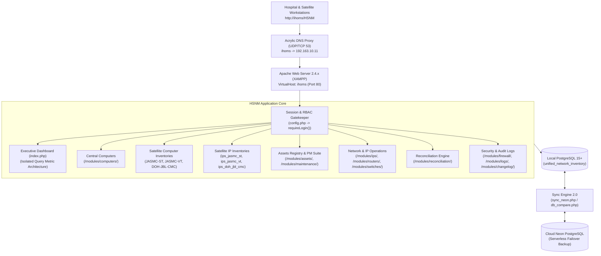
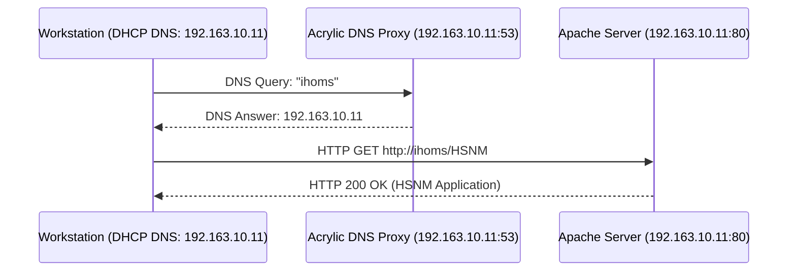
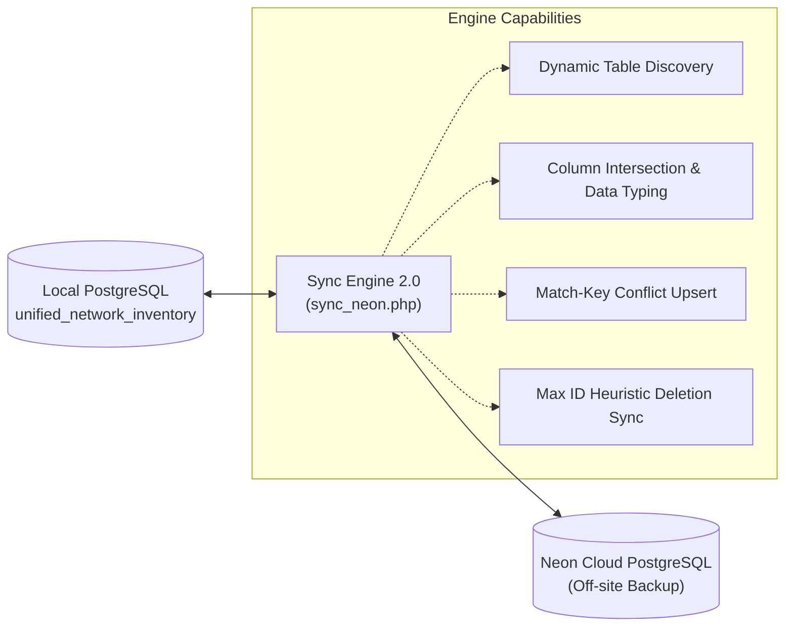

# Hardware & Security Network Management (HSNM)
## Comprehensive System Technical Documentation & Manual
**Version:** v1.15.6  
**Last Updated:** November 11, 2026  
**Primary Maintainer / Author:** IHOMS-MIKE  
**Target Environment:** Local Intranet (`http://ihoms/HSNM` / `192.163.10.11`) & Neon Cloud Failover

---

## Table of Contents
1. [System Overview & Architecture](#1-system-overview--architecture)
2. [Technical Stack & Environment Setup](#2-technical-stack--environment-setup)
3. [Directory Layout & File Structure](#3-directory-layout--file-structure)
4. [Security, Authentication & Role-Based Access Control (RBAC)](#4-security-authentication--role-based-access-control-rbac)
5. [Core Functional Modules](#5-core-functional-modules)
   - [5.1 Central Computer Inventory (`/modules/computers/`)](#51-central-computer-inventory-modulescomputers)
   - [5.2 Multi-Facility Satellite Computers (`jasmc_st`, `jasmc_vt`, `doh_jbl_cmc`)](#52-multi-facility-satellite-computers-jasmc_st-jasmc_vt-doh_jbl_cmc)
   - [5.3 Multi-Facility Satellite IP Management (`ips_jasmc_st`, `ips_jasmc_vt`, `ips_doh_jbl_cmc`)](#53-multi-facility-satellite-ip-management-ips_jasmc_st-ips_jasmc_vt-ips_doh_jbl_cmc)
   - [5.3a Outsourced Inventory Modules (`outsourced`, `ips_outsourced`)](#53a-outsourced-inventory-modules-outsourced-ips_outsourced)
   - [5.4 Capital Asset Registry (`/modules/assets/`)](#54-capital-asset-registry-modulesassets)
   - [5.5 Preventive Maintenance (PM) Suite (`/modules/maintenance/`)](#55-preventive-maintenance-pm-suite-modulesmaintenance)
   - [5.6 Hospital IP Address Management (`/modules/ips/`)](#56-hospital-ip-address-management-modulesips)
   - [5.7 Reconciliation Engine (`/modules/reconciliation/`)](#57-reconciliation-engine-modulesreconciliation)
   - [5.8 Network Infrastructure: Routers, Switches & Firewall](#58-network-infrastructure-routers-switches--firewall)
   - [5.9 Software Licensing: Microsoft Office (`/modules/office/`)](#59-software-licensing-microsoft-office-modulesoffice)
   - [5.10 Auxiliary Hospital Modules (PABX, Printers, TVs, ICS, Links)](#510-auxiliary-hospital-modules-pabx-printers-tvs-ics-links)
   - [5.11 Reporting, Auditing, Changelog & User Settings](#511-reporting-auditing-changelog--user-settings)
6. [Complete Database Schema & Data Dictionary](#6-complete-database-schema--data-dictionary)
7. [Network Topology, DNS Proxy & VirtualHost Setup](#7-network-topology-dns-proxy--virtualhost-setup)
8. [Database Cloud Synchronization 2.0 & Disaster Recovery](#8-database-cloud-synchronization-20--disaster-recovery)
9. [Chronological Revision History (v1.0.0 – v1.15.6)](#9-chronological-revision-history-v100--v1156)
10. [System Administration & Operational Runbook](#10-system-administration--operational-runbook)

---

## 1. System Overview & Architecture

**Hardware & Security Network Management (HSNM)** is an enterprise healthcare IT infrastructure, network operations, and asset lifecycle platform designed for regional hospitals and affiliated satellite health centers. Built to replace fragmented spreadsheets, manual logbooks, and isolated tracking scripts, HSNM unifies physical workstation tracking, branch facility operations, IP subnet allocations, non-ICMP network diagnostic polling, software license compliance, and preventive maintenance audits.



### Architectural Principles
- **Framework-Free Simplicity**: Written in pure PHP 8.1+ using native `PDO_PGSQL` prepared statements for high throughput, minimal overhead, and instant debugging.
- **Centralized Bootstrap**: All execution threads initialize through `config.php`, which establishes database connections, enforces session security, injects CSRF tokens, and provides audit trail helpers.
- **Self-Contained Functional Modules**: Each module resides in its own subfolder under `/modules/`, handling its own GET filtering, pagination, and CSRF-protected POST actions.
- **Offline Air-Gap Readiness**: Google Fonts and Material Symbols icons are self-hosted locally as WOFF2 binaries in `assets/fonts/`, supported by a local Tailwind CSS bundle to guarantee zero latency and UI consistency during WAN outages.
- **Query Isolation**: Dashboard KPI queries operate in isolated try-catch closures (`$safeCount`, `$safeSum`), preventing schema drift or single-table errors from zeroing out dashboard metrics.

---

## 2. Technical Stack & Environment Setup

| Layer | Technology | Version / Configuration |
|---|---|---|
| **Host Operating System** | Windows Server / Windows 10/11 Pro | Static intranet IP configured via `LOCAL_HOST_IP` |
| **Web Server** | Apache HTTP Server (XAMPP) | v2.4.x with `mod_rewrite`, `mod_env`, `mod_vhost_alias` |
| **Programming Language** | PHP | 8.1+ with `pdo_pgsql`, `zip`, `openssl`, `mbstring`, `curl` |
| **Primary Database** | PostgreSQL Server | 15.x on `localhost:5432` (`unified_network_inventory`) |
| **Cloud Failover Database** | Neon PostgreSQL | Serverless cloud instance with SSL pooling (`sslmode=require`) |
| **Local DNS Engine** | Acrylic DNS Proxy | Port 53 multi-subnet DNS broadcast for hospital `/21` LAN |
| **Styling & UI Framework** | Tailwind CSS | Utility-first CSS with dark/light mode local storage persistence |
| **Typography & Icons** | Local WOFF2 Binaries | Inter (Latin) and Material Symbols Outlined self-hosted |
| **Cloud Deployments** | Render / Vercel | Containerized deploy via `start.sh` & `vercel.json` |

### Zero-Hardcoding Security Architecture
To ensure code portability across local intranet servers, public Git repositories, and cloud staging environments:
- **`LOCAL_HOST_IP`**: The server's physical IP address is injected dynamically via Apache's `httpd.conf` (`SetEnv LOCAL_HOST_IP 192.163.10.11`). Source code files read `getenv('LOCAL_HOST_IP')` for allowlist checks.
- **`BASE_URL`**: Configured dynamically in `config.php` to resolve `/HSNM` in local subdirectory environments and `""` when deployed to root domains on Render or Railway.
- **Database Connection Cascade**: Evaluates `DATABASE_URL` (Railway), `POSTGRES_URL` (Vercel/Neon), and defaults to local PostgreSQL parameters (`localhost:5432`).

---

## 3. Directory Layout & File Structure

```
c:/xampp/htdocs/HSNM/
├── config.php                     # Central configuration, DB connection, RBAC, CSRF, & audit helpers
├── index.php                      # Executive dashboard with isolated query metrics
├── login.php                      # Secure authentication gateway with session timeout enforcement
├── logout.php                     # Session termination, cookie invalidation, & redirect handling
├── db_compare.php                 # Database schema & row-count comparator (Local vs. Cloud)
├── sync_neon.php                  # Multi-table cloud synchronization engine 2.0 with unique constraint handling
├── run_status_migration.php       # Interactive database schema migration executor
├── run_computers_to_assets_sync.php # One-click computer to asset registry migration & PMS seeding runner
├── README.md                      # System overview and quick-start guide
├── SYSTEM_DOCUMENTATION.md        # Comprehensive technical manual (this document)
├── USER_MANUAL.md                 # User operations and standard operating procedures (SOP)
├── walkthrough.md                 # In-depth architectural and developer walkthrough guide
├── System Walkthrough Guide.md    # Canonical developer guide mirror
├── assets/                        # Offline styling, local fonts, and icons
│   ├── css/fonts.css              # Self-hosted typography stylesheets
│   ├── fonts/                     # WOFF2 binaries (Inter, Material Symbols)
│   └── js/tailwind.js             # Standalone Tailwind CSS JavaScript bundle
├── database/                      # SQL migrations, baseline exports, and diagnostic tools
│   ├── add_status_and_satellite_tables.sql  # Schema for satellite computer inventories & status columns
│   ├── add_satellite_ip_tables.sql          # Schema for satellite IP inventories (ST, VT, CMC)
│   ├── add_assets_maintenance_tables.sql    # Schema for assets and PM checklists
│   ├── add_maintenance_status_option.sql    # Allows 'Maintenance' status across computer/satellite tables
│   ├── add_module_access.sql                # User JSONB permission migration
│   ├── widen_status_and_flag_columns.sql    # Column width extensions
│   └── schema_export.sql                    # Full baseline database export
├── includes/                      # Global UI components & shared partials
│   ├── header.php                 # Meta tags, stylesheets, top navbar, & theme toggle
│   ├── sidebar.php                # Left navigation tree with RBAC visibility controls & version badge
│   ├── footer.php                 # Script tags, modal containers, & layout closers
│   ├── satellite_computer_tabs.php # Switcher tabs for computer inventories
│   └── satellite_ip_tabs.php      # Switcher tabs for IP inventories
└── modules/                       # Functional business modules
    ├── computers/                 # Central Computer Inventory & satellite transfer hub
    │   ├── index.php              # Computer inventory list, Excel/CSV export, sectioned modals
    │   └── _form_fields.php       # Shared reusable form partial for computer records
    ├── jasmc_st/                  # JASMC-ST Satellite Computer Inventory
    ├── jasmc_vt/                  # JASMC-VT Satellite Computer Inventory
    ├── doh_jbl_cmc/               # DOH-JBL-CMC Satellite Computer Inventory
    ├── ips/                       # IP Address Management, ping diagnostics, & ARP scanner
    ├── ips_jasmc_st/              # JASMC-ST Satellite IP Inventory
    ├── ips_jasmc_vt/              # JASMC-VT Satellite IP Inventory
    ├── ips_doh_jbl_cmc/           # DOH-JBL-CMC Satellite IP Inventory
    ├── outsourced/                # Outsourced Computer Inventory (JBL-OS-* control numbers)
    ├── ips_outsourced/            # Outsourced IP Address Inventory (JBL-OS-* control numbers)
    ├── assets/                    # General Asset Inventory & Property Tracking
    │   ├── index.php              # Asset catalog, financial costs, PTR numbers, exports
    │   ├── _asset_form.php        # Sectioned asset input partial
    │   └── print.php              # Official printable Computer Unit Inventory Form
    ├── maintenance/               # Preventive Maintenance (PM) Checklist & Inspection History
    │   ├── index.php              # 22-point audit checklist, scoring engine, and logs
    │   └── print.php              # Official printable Computer PM Checklist certificate
    ├── routers/                   # Network Router inventory & status ping
    ├── switches/                  # Network Switch & port management
    ├── firewall/                  # Endpoint security & firewall compliance
    ├── reconciliation/            # Compare & Sync: IP-to-Computer conflict resolution
    ├── office/                    # Microsoft Office License assignment & key tracking
    ├── printers/                  # Standalone printer inventory & departmental mapping
    ├── pabx/                      # Hospital Telephone Directory & PABX extensions
    ├── queueing_tv/               # OPD / Waiting Area Queue Display TV management
    ├── ics/                       # Inventory Custodian Slip (ICS) tracking
    ├── ihoms_links/               # Integrated Hospital Operations Management shortcuts
    ├── reports/                   # Cross-module tabular reporting & bulk data dumps
    ├── logs/                      # Audit trails, modification diffs, & actor tracking
    ├── changelog/                 # File checksum differential change detector & version log
    └── settings/                  # User accounts, passwords, & module permission matrices
```

---

## 4. Security, Authentication & Role-Based Access Control (RBAC)

### 4.1 Authentication Gateway (`login.php`)
- **Password Hashing**: Employs PHP's `PASSWORD_BCRYPT` with auto-salting.
- **Session Hardening**:
  - `session_regenerate_id(true)` is executed immediately upon successful password verification.
  - Cookie flags: `HttpOnly` (mitigates XSS cookie theft), `SameSite=Lax`.
  - Inactivity Timeout: Automatically expires idle sessions after 30 minutes of inactivity.
  - Anti-Caching Headers: Emits `Cache-Control: no-store, no-cache, must-revalidate` on authenticated views to prevent back-button cache restoration.

### 4.2 Role-Based Access Control (RBAC)
User permissions are stored as a JSONB array (`module_access`) within the `users` table:
```json
["computers", "jasmc_st", "jasmc_vt", "doh_jbl_cmc", "assets", "maintenance", "ips", "ips_jasmc_st", "ips_jasmc_vt", "ips_doh_jbl_cmc", "routers", "switches", "office", "firewall"]
```
Access checks are handled globally by `canAccessModule($module_slug)`:
```php
function canAccessModule($module) {
    if (!isset($_SESSION['user_id'])) return false;
    if (isset($_SESSION['role']) && $_SESSION['role'] === 'admin') return true;
    if (!isset($_SESSION['module_access']) || $_SESSION['module_access'] === null) return true;
    $allowed = json_decode($_SESSION['module_access'], true);
    return is_array($allowed) && in_array($module, $allowed);
}
```

### 4.3 CSRF Protection
Every state-altering HTTP `POST` request requires a valid CSRF token:
- Injected via `getCsrfInput()`: `<input type="hidden" name="csrf_token" value="...">`
- Verified via `verifyCsrfToken()` before processing any insert, update, or delete commands.

### 4.4 Centralized Audit Logging (`logAudit()`)
All system actions log to the `audit_logs` table:
- **Recorded Data**: User ID, username, action type, description of change (with field-level diffs for edits), IP address, resource category, target ID, and timestamp.

---

## 5. Core Functional Modules

### 5.1 Central Computer Inventory (`/modules/computers/`)
The primary workstation inventory tracking all desktop computers and laptops in the central hospital facility.
- **Lifecycle Statuses**:
  - `Working` (Green badge): Operating normally.
  - `Maintenance` (Yellow badge): Currently under inspection or repair.
  - `Transferred` (Blue badge): Relocated to an external satellite facility.
  - `Condemned` (Red badge): Decommissioned, damaged, or scrap.
- **Transfer Destination Workflow**:
  - Selecting `Transferred` in the Add or Edit modal immediately opens the **Transfer Destination Dialog**.
  - Options: `JASMC-ST`, `JASMC-VT`, `DOH-JBL-CMC`.
  - Automated Replication: Saving a transferred record automatically copies the entire workstation specification into the satellite facility's database table (`computers_jasmc_st`, `computers_jasmc_vt`, or `computers_doh_jbl_cmc`), resetting status to `Working` at the new site and preserving `source_computer_id`.
- **Sectioned Card Modals**:
  Organized into 7 clear visual sections:
  1. *General Information* (Building, Floor, Department, End User, MR/PAR, Control #, Status)
  2. *System Unit* (Make/Model, System Unit S/N)
  3. *Core Hardware Specs* (Processor, RAM Memory, Storage)
  4. *Peripherals* (Monitor/SN, Mouse/SN, Keyboard/SN, Printer multi-select, Scanner, AVR/UPS)
  5. *System & Software* (OS, OS Key, License, MS Office, Office Email)
  6. *Network & Security* (IP Address, MAC Address, Endpoint Secure, Firewall)
  7. *Personnel & Remarks* (Checked By, Encoded By, Remarks Date, Remarks text)
- **High-Speed XLSX Export**: Generates raw OpenXML SpreadsheetML files using PHP's native `ZipArchive`.

### 5.2 Multi-Facility Satellite Computers (`jasmc_st`, `jasmc_vt`, `doh_jbl_cmc`)
Three dedicated satellite modules mirroring the headquarters computer inventory:
- **`JASMC-ST`** (`/modules/jasmc_st/` -> `computers_jasmc_st`) &mdash; JASMC &mdash; Sto. Tomas
- **`JASMC-VT`** (`/modules/jasmc_vt/` -> `computers_jasmc_vt`) &mdash; JASMC &mdash; Victoria Tarlac
- **`DOH-JBL-CMC`** (`/modules/doh_jbl_cmc/` -> `computers_doh_jbl_cmc`) &mdash; DOH-JBL Children's Medical Center
- **Features**:
  - Independent CRUD operations, search filters, and status selection (`All`, `Working`, `Maintenance`, `Transferred`, `Condemned`).
  - Cross-facility switcher tabs rendered at the top of each view (`includes/satellite_computer_tabs.php`) with real-time record count badges.
  - Source tracking via `source_computer_id` referencing parent headquarters record.
  - Independent Excel/CSV exports and printable rosters.
  - **Filter Dropdown Auto-Submit** (v1.15.6): `status`, `sort`, and `limit` selects include `onchange="this.form.submit()"` so filters apply immediately on selection, without requiring a manual "Filter" button click.

### 5.3 Multi-Facility Satellite IP Management (`ips_jasmc_st`, `ips_jasmc_vt`, `ips_doh_jbl_cmc`)
Dedicated IP management subsystems for each external branch facility:
- **Tables**: `ips_jasmc_st`, `ips_jasmc_vt`, `ips_doh_jbl_cmc`.
- **Shared Implementation**: Powered by `modules/ips/_satellite_ip_template.php`.
- **Features**:
  - Independent IP allocation, MAC tracking, device classification (`Workstation`, `Printer`, `Server`, `Access Point`), and location tagging.
  - Status management: `active`, `available`, `reserved`.
  - Top switcher tabs (`includes/satellite_ip_tabs.php`) allowing one-click navigation between Hospital Main IP space and branch facilities.
  - Diagnostic ICMP ping and ARP/MAC discovery for remote subnets.

### 5.3a Outsourced Inventory Modules (`outsourced`, `ips_outsourced`)

New in **v1.15.6**. These two modules expose equipment and IP records belonging to externally managed (outsourced/donated) units under the `JBL-OS-` control number namespace.

#### Architecture
- **No new database tables are created.** Both modules query the existing `computers` and `ips` tables respectively, scoped with a `WHERE control_number LIKE 'JBL-OS-%'` filter.
- The `LIKE 'JBL-OS-%'` pattern is intentionally strict — it **excludes** `JBL-OSM-%` and other similarly-prefixed namespaces, matching only records that start with exactly `JBL-OS-`.

#### Outsourced Computer Inventory (`modules/outsourced/`)
- **Source table**: `computers` filtered by `control_number LIKE 'JBL-OS-%'`
- **UI**: Violet theme, `handshake` Material Icon
- **Control number enforcement**:
  - **Client-side**: `enforceOsPrefix()` JavaScript function pre-fills the control number field with `JBL-OS-` and prevents submission if the prefix is removed.
  - **Server-side**: PHP validates that submitted `control_number` starts with `JBL-OS-` before any INSERT/UPDATE.
- **Exports**: Excel and CSV exports are scoped to `JBL-OS-%` records only.
- **Initial data**: 2 existing records visible immediately — `JBL-OS-HS-PC001`, `JBL-OS-RAD-PC031`.
- **URL**: `/modules/outsourced/`

#### Outsourced IP Address Inventory (`modules/ips_outsourced/`)
- **Source table**: `ips` filtered by `control_number LIKE 'JBL-OS-%'`
- **UI**: Violet theme, `handshake` Material Icon
- **Control number enforcement**: `enforceIpOsPrefix()` JS function + server-side PHP validation, identical pattern to the computer module.
- **Exports**: Excel and CSV scoped to `JBL-OS-%` records.
- **Main IP tab badge** still shows the **full** count (2,032 — JBL-OS- records are included in the Main `ips` module).
- **Initial data**: 11 existing records visible immediately.
- **URL**: `/modules/ips_outsourced/`

#### Tab & Sidebar Integration
| Component | Change |
|---|---|
| `includes/satellite_computer_tabs.php` | Added "Outsourced" tab (violet, `handshake` icon); active state: `outsourced`; live badge `SELECT COUNT(*) FROM computers WHERE control_number LIKE 'JBL-OS-%'` |
| `includes/satellite_ip_tabs.php` | Added "Outsourced" tab (violet, `handshake` icon); live badge `SELECT COUNT(*) FROM ips WHERE control_number LIKE 'JBL-OS-%'`; Main tab count unchanged |
| `includes/sidebar.php` | Added `ips_outsourced` active-page detection **before** the `ips` check (prevents substring collision); added "Outsourced IPs" link (violet) under IP Addresses section |

#### MAC Address Search Normalization (v1.15.6)
`modules/computers/index.php`, `modules/ips/index.php`, `modules/ips/_satellite_ip_template.php`, and `IP-Address-Inventory/index.php` normalize MAC address search input by converting colons (`:`) to hyphens (`-`) before executing the database query:
```php
$search = str_replace(':', '-', $search);
```
This ensures MAC addresses stored with hyphens (e.g., `00-1A-2B-3C-4D-5E`) are correctly found when users search using colon notation (e.g., `00:1A:2B:3C:4D:5E`).

### 5.4 Capital Asset Registry (`/modules/assets/`)
Tracks physical assets, procurement metadata, and financial valuation.
- **Fields**: Control ID, PTR Number, Item Code, Cost (PHP), Procurement Source (`Purchased`, `Donated`, `Transferred`), Brand/Model, Serial Number, Dedicated GPU, Peripherals.
- **One-Click Workstation Migration**:
  - `run_computers_to_assets_sync.php` executes transactional upsert of workstation records into `assets`.
  - Automatically seeds historical PM inspection records into `maintenance`.
- **Automated Synchronization Hook**:
  - Whenever a computer is added or edited, `syncComputerToAsset()` in `config.php` automatically upserts the corresponding record into `assets`.
- **Official Print Roster**:
  - `modules/assets/print.php` renders official Computer Unit Inventory Forms formatted for printing with multi-select checkbox support.

### 5.5 Preventive Maintenance (PM) Suite (`/modules/maintenance/`)
A standardized 22-point digital inspection checklist replacing manual paperwork:
- **Hardware Audit Points (Pass / Fail / N/A)**:
  1. Monitor Display & Casing
  2. System Unit Interior Cleanliness
  3. Keyboard Key Action
  4. Mouse Tracking & Buttons
  5. Storage Drive S.M.A.R.T. Health
  6. Cable Routing & Condition
  7. Power Supply Unit & AVR Stability
  8. Cooling Fans & Airflow
  9. CPU Thermal Paste Condition
  10. USB / Audio / Network Ports
  11. Physical Casing Integrity
- **Software Audit Points (Pass / Fail / N/A)**:
  1. OS Patch Compliance
  2. Antivirus Definition Freshness
  3. Antivirus Full System Scan
  4. Temporary Files & Disk Cleanup
  5. Disk Defragmentation / TRIM Execution
  6. Startup Program Optimization
  7. Browser Cache & Temp Data
  8. Unauthorized Software Inspection
  9. Windows Firewall Verification
  10. Critical Data Backup Verification
  11. Event Viewer System Log Inspection
- **Dynamic Scoring Formula**:
  $$\text{Score} = \left( \frac{\text{Passed Checks}}{\text{Total Applicable Checks (excluding N/A)}} \right) \times 100$$
- **Sign-Off Workflow**: Captures observations, corrective actions taken, technician (`Checked By`), supervisor (`Verified By`), and audit date.
- **Official Print Certificate**:
  - `modules/maintenance/print.php` produces formal inspection certificates with pass/fail tables and dual sign-off blocks.

### 5.6 Hospital IP Address Management (`/modules/ips/`)
Comprehensive management of the hospital's IPv4 address allocation across `/21` subnets:
- **Status Categories**: `active`, `available`, `reserved`.
- **Network Discovery Engine**:
  - ICMP Echo Ping (single or batch concurrent).
  - ARP, NBTSTAT, and GETMAC polling capable of discovering active devices even when Windows Firewall drops ICMP packets.
- **Hostname Resolution**: Resolves NetBIOS/DNS hostnames and updates the database immediately.

### 5.7 Reconciliation Engine (`/modules/reconciliation/`)
An automated audit tool comparing the **IP Address Inventory** against the **Computer Inventory**:
- **Data Mismatches**: Identifies records sharing a `control_number` but having diverging IP or MAC addresses.
- **Identity Conflicts**: Flags duplicate IPs or MAC addresses assigned to different control numbers.
- **One-Click Sync**: Allows administrators to push IP values to Computer records or pull Computer values into IP records instantly.

### 5.8 Network Infrastructure: Routers, Switches & Firewall
- **Routers (`/modules/routers/`)**: Tracks edge and branch routers, ISP circuit assignments, gateway IPs, and online status.
- **Switches (`/modules/switches/`)**: Catalogs core, distribution, and access switches, tracking port densities, VLANs, management IPs, and physical closet locations.
- **Firewall Compliance (`/modules/firewall/`)**: Tracks endpoint security agents (Athena EPP, Windows Defender) and firewall statuses across all workstations, with live toggles and department filters.

### 5.9 Software Licensing: Microsoft Office (`/modules/office/`)
- Tracks Microsoft Office suites (Office 2016, 2019, 2021, Microsoft 365).
- Manages product keys, associated Microsoft login emails, assigned computers, and installation dates.
- Automatic Sync: When MS Office is entered in Computer Inventory, it automatically updates or creates an entry in Office Licenses.

### 5.10 Auxiliary Hospital Modules (PABX, Printers, TVs, ICS, Links)
- **`printers`**: Catalogs network, shared, and local desktop printers, cartridge models, and departmental allocations.
- **`pabx`**: Hospital-wide telephone extension directory with quick search by employee name or department.
- **`queueing_tv`**: Manages television displays and mini-PCs powering patient queue numbering in OPD and waiting areas.
- **`ics`**: Inventory Custodian Slip management for low-value tangible assets with printable government slips.
- **`ihoms_links`**: Curated directory of internal hospital information systems, laboratory portals, and clinical shortcuts.

### 5.11 Reporting, Auditing, Changelog & User Settings
- **`reports`**: Cross-tabulation reports grouped by department, building, floor, hardware specifications, and lifecycle statuses.
- **`logs`**: Central activity log with category filters (User, IP, Computer, Reconciliation, System) and export tools.
- **`changelog`**: Automated code change detector using MD5 checksums, paired with a version history timeline displaying current system revision (`v1.15.6`).
- **`settings`**: User account management, password resets, role assignment (`Admin`, `Editor`, `Viewer`), and JSONB permission checkboxes.

---

## 6. Complete Database Schema & Data Dictionary

### Summary of System Tables (22 Tables)

| Table Name | Primary Purpose | Key Unique / Matching Column |
|---|---|---|
| `computers` | Central Workstation Inventory | `id`, `control_number` |
| `computers_jasmc_st` | JASMC-ST Branch Workstations | `control_number` |
| `computers_jasmc_vt` | JASMC-VT Branch Workstations | `control_number` |
| `computers_doh_jbl_cmc`| DOH-JBL-CMC Branch Workstations | `control_number` |
| `assets` | Capital & Tangible Assets | `control_id` |
| `maintenance` | Preventive Maintenance Audits | `id` (references `assets.id`, `computers.id`) |
| `ips` | Hospital Main IP Space | `ip_address` |
| `ips_jasmc_st` | JASMC-ST IP Address Space | `ip_address` |
| `ips_jasmc_vt` | JASMC-VT IP Address Space | `ip_address` |
| `ips_doh_jbl_cmc` | DOH-JBL-CMC IP Address Space | `ip_address` |
| `subnets` | IPv4 Subnets & VLAN Definitions | `id` |
| `routers` | Network Router Catalog | `serial_number`, `ip_address` |
| `switches` | Network Switchgear Catalog | `switch_id` |
| `firewall_status` | Endpoint Firewall Audit Records | `control_number` |
| `office_licenses` | Software Licensing & Account Keys | `control_number`, `email` |
| `ics_inventory` | Inventory Custodian Slips | `id` |
| `printers` | Standalone Printer Catalog | `printer_no` |
| `queueing_tvs` | Waiting Area Display Displays | `id` |
| `pabx_directory` | Hospital Telephone Extensions | `local_number` |
| `ihoms_links` | Internal System Bookmarks | `id` |
| `users` | User Accounts & RBAC Permissions | `username` |
| `audit_logs` | System Activity & Audit Trail | `id` |

---

## 7. Network Topology, DNS Proxy & VirtualHost Setup

Workstations across the hospital intranet access the system via `http://ihoms/HSNM` using Acrylic DNS Proxy:



### Configuration Instructions
1. **Acrylic DNS Proxy Setup**:
   - In `C:\Program Files (x86)\Acrylic DNS Proxy\AcrylicHosts.txt`:
     ```
     192.163.10.11 ihoms
     ```
   - In `C:\Program Files (x86)\Acrylic DNS Proxy\AcrylicConfiguration.ini`:
     ```ini
     PrimaryServerAddress=8.8.8.8
     SecondaryServerAddress=8.8.4.4
     [AllowedAddressesSection]
     IP1=192.163.8.*
     IP2=192.163.9.*
     IP3=192.163.10.*
     IP4=192.163.11.*
     IP5=192.163.12.*
     IP6=192.163.13.*
     IP7=192.163.14.*
     IP8=192.163.15.*
     IP9=127.0.0.1
     ```
2. **Apache VirtualHost Configuration** (`httpd-vhosts.conf`):
   ```apache
   <VirtualHost *:80>
       DocumentRoot "C:/xampp/htdocs"
       ServerName ihoms
       ServerAlias 192.163.10.11
       <Directory "C:/xampp/htdocs">
           Options Indexes FollowSymLinks
           AllowOverride All
           Require all granted
       </Directory>
   </VirtualHost>
   ```
3. **Environment Variable Injection** (`httpd.conf`):
   ```apache
   SetEnv LOCAL_HOST_IP 192.163.10.11
   ```
4. **Firewall Inbound Rules**:
   Allow UDP and TCP port 53 for remote subnet `192.163.8.0/21`.

---

## 8. Database Cloud Synchronization 2.0 & Disaster Recovery

HSNM includes an enterprise-grade cloud synchronization engine (`sync_neon.php`) that bridges the local hospital database with a remote Neon Serverless PostgreSQL instance.



### Key Engineering Features of Sync 2.0:
1. **Dynamic Table Discovery**: Queries `information_schema.tables` on both local and remote endpoints to detect table availability dynamically. Missing remote tables are flagged with SQL migration suggestions rather than aborting.
2. **Column Intersection & Type Casting**: Inspects `information_schema.columns` to build intersection sets of matching columns. Automatically maps and binds data types (booleans, timestamps, numbers, JSONB).
3. **Match-Key Conflict Resolution**: For tables with natural keys (e.g., `control_number`, `ip_address`, `username`, `control_id`), updates existing rows using `match` columns to resolve unique constraint collisions.
4. **Bi-Directional Deletion Reconciliation**: Tracks deleted rows using a max ID watermark heuristic. When enabled via the **Allow Deletion Sync** option, rows purged locally are safely purged on the remote instance.
5. **Full 22-Table Coverage**: Synchronizes all inventory, satellite, licensing, and configuration tables in topological dependency order.

---

## 9. Chronological Revision History (v1.0.0 – v1.15.6)

| Version | Date | Module | Type | Technical Summary |
|---|---|---|---|---|
| **v1.15.6** | 2026-11-11 | Outsourced Modules & Fixes | `feature` / `fix` | **Outsourced Inventory Modules, Filter UX & MAC Normalization:** Added `modules/outsourced/` (Outsourced Computer Inventory) and `modules/ips_outsourced/` (Outsourced IP Inventory) — both filter the existing `computers`/`ips` tables by `control_number LIKE 'JBL-OS-%'` with no new DB tables. Violet UI, `handshake` icon, `enforceOsPrefix()` / `enforceIpOsPrefix()` client+server prefix enforcement, scoped Excel/CSV exports. Added "Outsourced" tab to both switcher tab bars and "Outsourced IPs" sidebar link. Fixed filter dropdown auto-submit (`onchange="this.form.submit()"`) in JASMC-ST, JASMC-VT, DOH-JBL-CMC satellite modules. Fixed MAC address search to normalize `:` → `-` before querying. |
| **v1.15.5** | 2026-11-11 | Satellites & Core | `feature` | **Multi-Facility Satellite IP Inventories & Resilient Sync:** Added dedicated Satellite IP Address Management modules (`ips_jasmc_st`, `ips_jasmc_vt`, `ips_doh_jbl_cmc`) with shared template architecture and top switcher tabs. Implemented query-isolated dashboard metrics (`$safeCount`, `$safeSum`) in `index.php` preventing schema drift from zeroing metrics. Upgraded `sync_neon.php` to Sync Engine 2.0 with dynamic table discovery, column intersection, and unique constraint resolution across all 22 system tables. Added self-hosted offline fonts (Inter, Material Symbols WOFF2) and local Tailwind JS bundle. Implemented printable official PM checklists and Asset inventory sheets. Added `'Maintenance'` status option. |
| **v1.15.4** | 2026-10-28 | Asset Management | `feature` | **Computers to Assets & Maintenance One-Click Migration Runner:** Created interactive web migration utility (`run_computers_to_assets_sync.php`) accessible directly from Asset Inventory header before Export Excel. Executes conflict-safe upsert of 872 workstations into `assets` and seeds 574 historical PMS audit logs into `maintenance` with dual foreign key linkage. Added real-time `syncComputerToAsset()` hooks on computer additions/updates. |
| **v1.15.3** | 2026-10-27 | Dashboard | `enhancement` | **Unified Dashboard Overview Overhaul:** Redesigned main dashboard (`index.php`) featuring 4-metric executive ribbon (Tracked Devices, IP Allocation, Satellite Units, Sync Integrity), dedicated Satellite Hospital Inventories Hub (JASMC-ST, JASMC-VT, DOH-JBL-CMC), workstation status breakdown (Working, Maintenance, Transferred, Condemned), full Asset Inventory & PM KPI cards, and reorganized Quick Action shortcuts. |
| **v1.15.2** | 2026-10-27 | System Core | `enhancement` | **Version Reflection & Unified Transfer Workflow:** Resolved missing version on login page and changelog header. Added transfer destination selection directly to Add Computer modal. Added visual transfer destination badges (`→ Transferred to: <FACILITY>`). Updated executive dashboard batch query to include satellite inventories (`ST`, `VT`, `JBL`). |
| **v1.15.1** | 2026-10-27 | Computer Inventory | `ui-redesign` | **Sectioned Card Modal Architecture:** Modernized Add and Edit computer modals into categorized cards. Fixed `edit_transferred_to_display` null reference exception. |
| **v1.15.0** | 2026-10-27 | Asset Management | `feature` | **Asset & Preventive Maintenance Suite:** Built new `/modules/assets/` and `/modules/maintenance/` modules. Implemented 22-point hardware/software PM checklist with real-time scoring (0-100%). Granted permissions to users. |
| **v1.14.0** | 2026-10-26 | Computers & Satellites | `feature` | **Multi-Facility Satellite Inventories:** Added status tracking (`Working`, `Transferred`, `Condemned`) and transfer destination popup dialog. Built satellite tables `computers_jasmc_st`, `computers_jasmc_vt`, `computers_doh_jbl_cmc` with automated cross-table replication upon transfer. |
| **v1.13.0** | 2026-10-23 | System Configuration | `security` | **IP Masking & Intranet DNS Setup:** Replaced hardcoded LAN IPs in PHP files with `LOCAL_HOST_IP` Apache environment variable. Configured Acrylic DNS Proxy and VirtualHost for `http://ihoms/HSNM` access across `/21` LAN. |
| **v1.12.0** | 2026-07-02 | Deployment Engine | `devops` | **Multi-Platform Deployments:** Added support for Neon cloud database pooling, Render containerized deployment (`Dockerfile`, `start.sh`), and Railway deployment configs. |
| **v1.11.23**| 2026-05-08 | Changelog Module | `maintenance` | **Changelog Cleanup:** Restricted changelog tracking strictly to code-level modifications, eliminating data entry clutter. |
| **v1.11.14**| 2026-04-20 | IP Address Management| `feature` | **Automated File Checksum Scanner:** Implemented SHA-256 file checksum scanner in `changelog` module to automatically log system file modifications. |
| **v1.5.0**  | 2026-02-09 | System Core | `refactor` | **Project Rebrand to HSNM:** Renamed project root from "Hardware Network Management" to "HSNM". Updated all absolute paths, session namespaces, `APP_NAME`, and `BASE_URL`. |
| **v1.4.5**  | 2026-02-05 | Dashboard | `ui-redesign` | **Executive Dashboard Alignment:** Aligned Quick Actions and Recent Activity cards into equal-height desktop rows with responsive flex layouts. |
| **v1.3.9**  | 2026-01-21 | IP Address Management| `feature` | **Non-ICMP MAC Discovery:** Enhanced ping diagnostics with ARP, NBTSTAT, and GETMAC scrapers to detect active endpoints behind Windows Firewalls. |
| **v1.3.1**  | 2026-01-15 | Reconciliation | `feature` | **Compare & Sync Engine:** Initial release of cross-table verification matching IP records against computer physical inventory. |
| **v1.0.0**  | 2026-01-01 | System Core | `feature` | **Initial Production Release:** Core architecture comprising Routers, Switches, IPs, Computers, MS Office, ICS, and PostgreSQL database. |

---

## 10. System Administration & Operational Runbook

### 10.1 Running Database Migrations
To execute schema updates via the web runner:
```
http://localhost/HSNM/run_status_migration.php
```
Or execute SQL migrations via `psql`:
```bash
psql -U postgres -d unified_network_inventory -f database/add_status_and_satellite_tables.sql
psql -U postgres -d unified_network_inventory -f database/add_assets_maintenance_tables.sql
psql -U postgres -d unified_network_inventory -f database/add_satellite_ip_tables.sql
psql -U postgres -d unified_network_inventory -f database/add_maintenance_status_option.sql
```

### 10.2 Synchronizing Workstations to Assets & Seeding PMS
Navigate to:
```
http://localhost/HSNM/run_computers_to_assets_sync.php
```
Click **Execute One-Click Sync** to reconcile all computer workstations into the Asset Registry and populate historical PM inspections.

### 10.3 Cloud Data Synchronization Protocol
1. Log in as an **Admin**.
2. Click **Data Sync** in the sidebar (`/sync_neon.php`).
3. Enter or verify the Neon PostgreSQL connection string.
4. Review table parity statistics.
5. Optionally check **Allow Deletion Sync** to propagate deletions.
6. Click **Execute Synchronization** and review execution logs.
