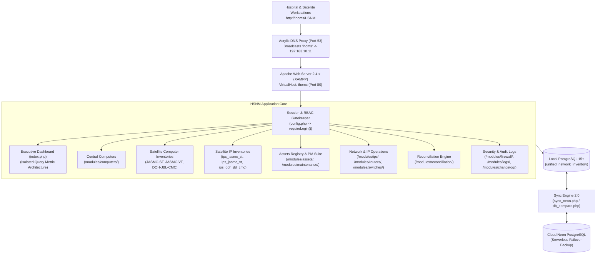

# HSNM — System Walkthrough Guide

[](modules/changelog/)
[](https://www.php.net/)
[](https://www.postgresql.org/)
[](https://tailwindcss.com/)

> **Hardware & Security Network Management (HSNM)** &mdash; an enterprise healthcare IT infrastructure, network operations, property asset lifecycle, and preventive maintenance audit platform built on native PHP 8.1+ and PostgreSQL 15+ (XAMPP stack), styled with Tailwind CSS.

---

## Table of Contents

1. [System Architecture](#1-system-architecture)
2. [Technology Stack](#2-technology-stack)
3. [Directory Structure](#3-directory-structure)
4. [Authentication & Session Management](#4-authentication--session-management)
5. [Front-End Layout & UI Architecture](#5-front-end-layout--ui-architecture)
6. [Role-Based Access Control (RBAC)](#6-role-based-access-control-rbac)
7. [Comprehensive Modules Walkthrough](#7-comprehensive-modules-walkthrough)
   - [7.1 Executive Dashboard (`index.php`) & Query Isolation Architecture](#71-executive-dashboard-indexphp--query-isolation-architecture)
   - [7.2 Central Computer Inventory (`modules/computers/`)](#72-central-computer-inventory-modulescomputers)
   - [7.3 Multi-Facility Satellite Computers (`jasmc_st`, `jasmc_vt`, `doh_jbl_cmc`)](#73-multi-facility-satellite-computers-jasmc_st-jasmc_vt-doh_jbl_cmc)
   - [7.3a Outsourced Inventory Module Architecture](#73a-outsourced-inventory-module-architecture)
   - [7.4 Hospital & Satellite IP Address Management](#74-hospital--satellite-ip-address-management)
   - [7.5 Capital Asset Registry (`modules/assets/`)](#75-capital-asset-registry-modulesassets)
   - [7.6 Preventive Maintenance (PM) Suite (`modules/maintenance/`)](#76-preventive-maintenance-pm-suite-modulesmaintenance)
   - [7.7 Network Hardware: Routers & Switches](#77-network-hardware-routers--switches)
   - [7.8 Reconciliation Engine (`modules/reconciliation/`)](#78-reconciliation-engine-modulesreconciliation)
   - [7.9 Software Licensing: Microsoft Office (`modules/office/`)](#79-software-licensing-microsoft-office-modulesoffice)
   - [7.10 Endpoint Security & Firewall Compliance (`modules/firewall/`)](#710-endpoint-security--firewall-compliance-modulesfirewall)
   - [7.11 Hospital Auxiliaries (Printers, PABX, Queueing TV, ICS, Links)](#711-hospital-auxiliaries-printers-pabx-queueing-tv-ics-links)
   - [7.12 Administration, Auditing & Reports (Logs, Settings, Changelog, Reports)](#712-administration-auditing--reports-logs-settings-changelog-reports)
   - [7.13 Cloud Database Synchronization Engine 2.0 (`sync_neon.php`)](#713-cloud-database-synchronization-engine-20-sync_neonphp)
8. [Database Schema & Data Dictionary (All 22 Tables)](#8-database-schema--data-dictionary-all-22-tables)
9. [Back-End Architectural Patterns](#9-back-end-architectural-patterns)
10. [Security Hardening & Zero-Hardcoding Architecture](#10-security-hardening--zero-hardcoding-architecture)
11. [Operational Runbook & Deployment Guide](#11-operational-runbook--deployment-guide)

---

## 1. System Architecture

HSNM operates as a high-performance intranet web platform backed by a local PostgreSQL database server, connected via an automated bi-directional synchronization bridge to a cloud-hosted Neon serverless PostgreSQL instance for disaster recovery.



### Architectural Principles
- **Framework-Free Simplicity**: Pure PHP 8.1+ using native `PDO_PGSQL` prepared statements. Eliminates vendor framework overhead, ensures instant loading, and provides 100% transparent control over queries and memory.
- **Centralized Bootstrap**: All execution threads initialize through `config.php`, which establishes database connections, enforces session security, injects CSRF tokens, and provides audit trail helpers.
- **Self-Contained Functional Modules**: Each module resides in its own subfolder under `/modules/`, handling its own GET filtering, pagination, and CSRF-protected POST actions.
- **Offline Air-Gap Readiness**: Google Fonts and Material Symbols icons are self-hosted locally as WOFF2 binaries in `assets/fonts/`, supported by a local Tailwind CSS bundle to guarantee zero latency and UI consistency during WAN outages.
- **Query Isolation**: Dashboard KPI queries operate in isolated try-catch closures (`$safeCount`, `$safeSum`), preventing schema drift or single-table errors from zeroing out dashboard metrics.

---

## 2. Technology Stack

| Layer | Technology | Version / Configuration |
|---|---|---|
| **Web Server** | Apache HTTP Server (XAMPP) | v2.4.x with `mod_rewrite`, `mod_env`, `mod_vhost_alias` |
| **Backend Language** | PHP | 8.1+ with `pdo_pgsql`, `zip`, `openssl`, `mbstring`, `curl` |
| **Primary Database** | PostgreSQL Server | 15.x on `localhost:5432` (`unified_network_inventory`) |
| **Cloud Failover Database** | Neon PostgreSQL | Serverless cloud instance with SSL pooling (`sslmode=require`) |
| **Local DNS Engine** | Acrylic DNS Proxy | Port 53 multi-subnet DNS broadcast for hospital `/21` LAN |
| **Styling & UI Framework** | Tailwind CSS | Utility-first CSS with dark/light mode local storage persistence |
| **Typography & Icons** | Local WOFF2 Binaries | Inter (Latin) and Material Symbols Outlined self-hosted |
| **Spreadsheet Engine** | Native OpenXML SpreadsheetML | Generated via PHP `ZipArchive` without 3rd-party memory bloat |
| **Container & Cloud Deploy** | Render / Vercel | Containerized deploy via `start.sh` & `vercel.json` |

---

## 3. Directory Structure

```
c:/xampp/htdocs/HSNM/
├── config.php                     # Central bootstrap: DB connection, RBAC, CSRF, & audit helpers
├── index.php                      # Executive dashboard with isolated query metrics
├── login.php                      # Authentication gateway with session timeout enforcement
├── logout.php                     # Session termination, cookie invalidation, & redirect handling
├── db_compare.php                 # Database schema & row-count comparator (Local vs. Cloud)
├── sync_neon.php                  # Multi-table cloud synchronization engine 2.0 with unique constraint handling
├── run_status_migration.php       # Interactive database schema migration executor
├── run_computers_to_assets_sync.php # One-click computer to asset registry migration & PMS seeding runner
├── README.md                      # System overview and quick-start guide
├── SYSTEM_DOCUMENTATION.md        # Detailed technical architecture and system manual
├── USER_MANUAL.md                 # User operations and standard operating procedures (SOP)
├── walkthrough.md                 # Developer & architecture walkthrough guide
├── System Walkthrough Guide.md    # Canonical developer guide mirror (this document)
├── assets/                        # Offline styling, local fonts, and icons
│   ├── css/fonts.css              # Self-hosted typography stylesheets
│   ├── fonts/                     # WOFF2 binaries (Inter, Material Symbols)
│   └── js/tailwind.js             # Standalone Tailwind CSS JavaScript bundle
├── database/                      # SQL migrations, baseline exports, and diagnostic tools
│   ├── add_status_and_satellite_tables.sql  # Schema for satellite computer inventories & status columns
│   ├── add_satellite_ip_tables.sql          # Schema for satellite IP inventories (ST, VT, CMC)
│   ├── add_assets_maintenance_tables.sql    # Schema for assets and PM checklists
│   ├── add_maintenance_status_option.sql    # Allows 'Maintenance' status across computer/satellite tables
│   ├── add_module_access.sql                # User JSONB permission migration
│   ├── widen_status_and_flag_columns.sql    # Column width extensions
│   └── schema_export.sql                    # Full baseline database export
├── includes/                      # Global UI components & shared partials
│   ├── header.php                 # Meta tags, stylesheets, top navbar, & theme toggle
│   ├── sidebar.php                # Left navigation tree with RBAC visibility controls & version badge
│   ├── footer.php                 # Script tags, modal containers, & layout closers
│   ├── satellite_computer_tabs.php # Switcher tabs for computer inventories
│   └── satellite_ip_tabs.php      # Switcher tabs for IP inventories
└── modules/                       # Functional business modules
    ├── computers/                 # Central Workstation inventory & satellite transfer hub
    │   ├── index.php              # Computer inventory list, Excel/CSV export, sectioned modals
    │   └── _form_fields.php       # Shared reusable form partial for computer records
    ├── jasmc_st/                  # JASMC-ST Satellite Computer Inventory
    ├── jasmc_vt/                  # JASMC-VT Satellite Computer Inventory
    ├── doh_jbl_cmc/               # DOH-JBL-CMC Satellite Computer Inventory
    ├── ips/                       # IP Address Management, ping diagnostics, & ARP scanner
    ├── ips_jasmc_st/              # JASMC-ST Satellite IP Inventory
    ├── ips_jasmc_vt/              # JASMC-VT Satellite IP Inventory
    ├── ips_doh_jbl_cmc/           # DOH-JBL-CMC Satellite IP Inventory
    ├── outsourced/                # Outsourced Computer Inventory (JBL-OS-* control numbers)
    ├── ips_outsourced/            # Outsourced IP Address Inventory (JBL-OS-* control numbers)
    ├── assets/                    # General Asset Inventory & Property Tracking
    │   ├── index.php              # Asset catalog, financial costs, PTR numbers, exports
    │   ├── _asset_form.php        # Sectioned asset input partial
    │   └── print.php              # Official printable Computer Unit Inventory Form
    ├── maintenance/               # Preventive Maintenance (PM) Checklist & Inspection History
    │   ├── index.php              # 22-point audit checklist, scoring engine, and logs
    │   └── print.php              # Official printable Computer PM Checklist certificate
    ├── routers/                   # Network Router inventory & status ping
    ├── switches/                  # Network Switch & port management
    ├── firewall/                  # Endpoint security & firewall compliance
    ├── reconciliation/            # Compare & Sync: IP-to-Computer conflict resolution
    ├── office/                    # Microsoft Office License assignment & key tracking
    ├── printers/                  # Standalone printer inventory & departmental mapping
    ├── pabx/                      # Hospital Telephone Directory & PABX extensions
    ├── queueing_tv/               # OPD / Waiting Area Queue Display TV management
    ├── ics/                       # Inventory Custodian Slip (ICS) tracking
    ├── ihoms_links/               # Integrated Hospital Operations Management shortcuts
    ├── reports/                   # Cross-module tabular reporting & bulk data dumps
    ├── logs/                      # Audit trails, modification diffs, & actor tracking
    ├── changelog/                 # File checksum differential change detector & version log
    └── settings/                  # User accounts, passwords, & module permission matrices
```

---

## 4. Authentication & Session Management

### Login Flow (`login.php`)
1. User enters username and password in the login gateway.
2. The server queries `users` table: `SELECT * FROM users WHERE username = ?`.
3. `password_verify($password, $user['password'])` evaluates the bcrypt hash.
4. On success:
   - `session_regenerate_id(true)` prevents session fixation attacks.
   - Populates session variables:
     - `$_SESSION['user_id']`
     - `$_SESSION['username']`
     - `$_SESSION['role']` (`admin`, `editor`, `viewer`)
     - `$_SESSION['module_access']` (JSON array of permitted module slugs)
     - `$_SESSION['last_activity'] = time()`
5. Redirects to `BASE_URL . '/'`.

### Session Guard (`requireLogin()`)
Every module entry point invokes:
```php
require_once __DIR__ . '/../../config.php';
requireLogin();
```
`requireLogin()` enforces:
- Presence of `$_SESSION['user_id']`.
- 30-minute idle session timeout:
  ```php
  if (isset($_SESSION['last_activity']) && (time() - $_SESSION['last_activity'] > 1800)) {
      session_unset();
      session_destroy();
      header("Location: " . BASE_URL . "/login?timeout=1");
      exit;
  }
  $_SESSION['last_activity'] = time();
  ```
- Anti-caching HTTP headers:
  ```php
  header("Cache-Control: no-store, no-cache, must-revalidate, max-age=0");
  header("Pragma: no-cache");
  ```

---

## 5. Front-End Layout & UI Architecture

### Responsive Desktop & Mobile Framework
Every authenticated page renders a consistent, accessible two-column layout:

```
┌─────────────────────────────────────────────────────────────┐
│ SIDEBAR (fixed 256px)       │ MAIN CONTENT AREA (flex-1)    │
│                             │ ┌───────────────────────────┐ │
│ [Logo] HSNM v1.15.5         │ │ Top Facility Switcher Tabs│ │
│ ─────────────────────────── │ └───────────────────────────┘ │
│ Overview (Dashboard)        │ Top Control Bar:              │
│ Routers                     │  - Module Title & Icon        │
│ Switches                    │  - Action Buttons (Add/Export)│
│ IP Addresses                │  - KPI Summary Badges         │
│   ↳ JASMC-ST                │ ───────────────────────────── │
│   ↳ JASMC-VT                │ Control Row:                  │
│   ↳ DOH-JBL-CMC             │  - Live Search (Debounced)    │
│ Computers                   │  - Dropdown Filters           │
│   ↳ JASMC-ST                │  - Pagination (15/50/100/All) │
│   ↳ JASMC-VT                │ ───────────────────────────── │
│   ↳ DOH-JBL-CMC             │ Sticky-Header Data Table      │
│ Asset Inventory             │ ───────────────────────────── │
│ Maintenance (PM Suite)      │ Bottom Pagination & Footer    │
│ Firewall Compliance         │                               │
│ MS Office Licenses          │                               │
│ Compare & Sync              │                               │
│ ICS Inventory               │                               │
│ PABX Directory              │                               │
│ IS Links                    │                               │
│ Printers                    │                               │
│ Queueing TV                 │                               │
│ Reports Engine              │                               │
│ ─────────────────────────── │                               │
│ Audit Logs                  │                               │
│ Settings (Admin)            │                               │
│ Changelog                   │                               │
│ Data Sync (Neon Cloud)      │                               │
│ ─────────────────────────── │                               │
│ 🌙 Dark/Light Mode Switcher │                               │
│ 👤 User Profile & Logout    │                               │
└─────────────────────────────────────────────────────────────┘
```

### Dark / Light Mode Switching
- Toggled by `toggleTheme()` in `assets/js/` and persisted in `localStorage.getItem('theme')`.
- Embedded early in `<head>` via `includes/header.php` to eliminate "flash of unstyled content" (FOUC).

---

## 6. Role-Based Access Control (RBAC)

User access is managed with granular flexibility:

| Role | Operational Scope | Administrative Privileges |
|---|---|---|
| **Admin** | Full read, write, and delete across all modules | Access to User Settings, Role Assignment, Permission Matrices, Audit Logs, and Cloud Data Sync (`sync_neon.php`) |
| **Editor** | Read, create, update, and export across permitted modules | Access to Audit Logs; no access to Settings, User Management, or Cloud Data Sync |
| **Viewer** | Read-only search, view, and export across permitted modules | No editing, deleting, audit logs, or settings access |

### Fine-Grained Module Matrix (`module_access`)
Each user has a `module_access` JSONB column in `users`:
```json
["computers", "jasmc_st", "jasmc_vt", "doh_jbl_cmc", "assets", "maintenance", "ips", "ips_jasmc_st", "ips_jasmc_vt", "ips_doh_jbl_cmc", "routers", "switches", "office", "firewall"]
```
Admin users bypass checks. Staff and viewers have menu items and page access filtered strictly by `canAccessModule($slug)`.

---

## 7. Comprehensive Modules Walkthrough

### 7.1 Executive Dashboard (`index.php`) & Query Isolation Architecture
Acts as the central command center for hospital IT management:
- **4-Metric Top Ribbon**: Displays Total Tracked Endpoints, Network IP Allocation %, Satellite Units deployed, and Cloud Sync Integrity.
- **Query Isolation Architecture**:
  ```php
  $safeCount = function($sql, $default = 0) use ($pdo) {
      if (!$pdo) return $default;
      try {
          $val = $pdo->query($sql)->fetchColumn();
          return $val !== false ? (int)$val : $default;
      } catch (Exception $e) {
          return $default;
      }
  };
  ```
  This pattern isolates every metric query. A single schema update or missing column in one table never zeroes out or crashes the dashboard.

---

### 7.2 Central Computer Inventory (`modules/computers/`)
The primary workstation inventory tracking all desktop computers and laptops in the central hospital facility.
- **Lifecycle Statuses**:
  - `Working` (Green badge): Operating normally.
  - `Maintenance` (Yellow badge): Currently under inspection or repair.
  - `Transferred` (Blue badge): Relocated to an external satellite facility.
  - `Condemned` (Red badge): Decommissioned, damaged, or scrap.
- **Sectioned Card Modals**:
  Organized into 7 clear visual sections:
  1. *General Information* (Building, Floor, Department, End User, MR/PAR, Control #, Status)
  2. *System Unit* (Make/Model, System Unit S/N)
  3. *Core Hardware Specs* (Processor, RAM Memory, Storage)
  4. *Peripherals* (Monitor/SN, Mouse/SN, Keyboard/SN, Printer multi-select, Scanner, AVR/UPS)
  5. *System & Software* (OS, OS Key, License, MS Office, Office Email)
  6. *Network & Security* (IP Address, MAC Address, Endpoint Secure, Firewall)
  7. *Personnel & Remarks* (Checked By, Encoded By, Remarks Date, Remarks text)
- **Automated Workstation-to-Asset Hook**:
  Every insert and update calls `syncComputerToAsset($pdo, $id)` in `config.php`, automatically upserting the workstation into `assets`.

---

### 7.3 Multi-Facility Satellite Computers (`jasmc_st`, `jasmc_vt`, `doh_jbl_cmc`)
- **`JASMC-ST`** (`/modules/jasmc_st/` -> `computers_jasmc_st`) &mdash; Sto. Tomas Branch
- **`JASMC-VT`** (`/modules/jasmc_vt/` -> `computers_jasmc_vt`) &mdash; Victoria Tarlac Branch
- **`DOH-JBL-CMC`** (`/modules/doh_jbl_cmc/` -> `computers_doh_jbl_cmc`) &mdash; Children's Medical Center
- **Automated Transfer Protocol**:
  - Setting a computer to `Transferred` triggers the transfer modal.
  - Confirming the destination clones the machine into the target satellite table with status `Working` and populates `source_computer_id`.
  - The central machine is marked `Transferred` with a destination badge (`→ Transferred to: <FACILITY>`).
- **Filter Dropdown Auto-Submit Pattern** (v1.15.6):
  All `<select>` filter elements (`status`, `sort`, `limit`) in satellite computer modules include the `onchange` attribute:
  ```html
  <select name="status" onchange="this.form.submit()">...</select>
  ```
  This eliminates the need for a separate "Filter" button click — selections apply instantly.

---

### 7.3a Outsourced Inventory Module Architecture

New in **v1.15.6**. Two new modules expose outsourced/donated equipment under the `JBL-OS-` control number namespace.

#### How They Are Built
Both modules follow the same approach: they are **scoped views** of the existing `computers` and `ips` tables, filtered by a `WHERE` clause rather than separate tables:

```php
// modules/outsourced/index.php — Outsourced Computer Inventory
$where = "WHERE control_number LIKE 'JBL-OS-%'";

// modules/ips_outsourced/index.php — Outsourced IP Inventory
$where = "WHERE control_number LIKE 'JBL-OS-%'";
```

The `LIKE 'JBL-OS-%'` pattern is strict — it does **not** match `JBL-OSM-%` or any other similarly-prefixed namespace.

#### Control Number Prefix Enforcement

**Client-side (JavaScript)**:
```javascript
// modules/outsourced/index.php
function enforceOsPrefix() {
    const field = document.getElementById('control_number');
    if (!field.value.startsWith('JBL-OS-')) {
        field.value = 'JBL-OS-';
    }
}

// modules/ips_outsourced/index.php
function enforceIpOsPrefix() {
    const field = document.getElementById('control_number');
    if (!field.value.startsWith('JBL-OS-')) {
        field.value = 'JBL-OS-';
    }
}
```

**Server-side (PHP)**:
```php
if (!str_starts_with($_POST['control_number'], 'JBL-OS-')) {
    $error = "Control number must start with JBL-OS-.";
}
```

#### Active Tab State
```php
// modules/outsourced/index.php
$active_comp_tab = 'outsourced';

// modules/ips_outsourced/index.php
$active_ip_tab = 'outsourced';
```
These variables are read by `includes/satellite_computer_tabs.php` and `includes/satellite_ip_tabs.php` respectively to highlight the active tab.

#### Tab Integration (`satellite_computer_tabs.php` / `satellite_ip_tabs.php`)
- Added a new **Outsourced** tab (violet background, `handshake` Material Icon) after the DOH-JBL-CMC tab.
- Live badge query for computers: `SELECT COUNT(*) FROM computers WHERE control_number LIKE 'JBL-OS-%'`
- Live badge query for IPs: `SELECT COUNT(*) FROM ips WHERE control_number LIKE 'JBL-OS-%'`
- Main IP tab badge still counts **all** `ips` records (JBL-OS- records included).

#### Sidebar Integration (`sidebar.php`)
```php
// IMPORTANT: ips_outsourced check must come BEFORE the ips check
// to prevent the 'ips' substring from matching 'ips_outsourced'
$active_page = 'ips_outsourced';  // set before the generic ips check
```
"Outsourced IPs" link added under the **IP Addresses** section (violet styling), mirroring the existing "Outsourced" link under **Computers**.

#### MAC Address Search Normalization (v1.15.6)
Search input in computer and IP modules is normalized before the query:
```php
// Normalize MAC address search: colon notation → hyphen notation
$search_normalized = str_replace(':', '-', $search);
// $search_normalized is then used in the LIKE %...% query
```
Affected files: `modules/computers/index.php`, `modules/ips/index.php`, `modules/ips/_satellite_ip_template.php`, `IP-Address-Inventory/index.php`.

---

### 7.4 Hospital & Satellite IP Address Management
- **Central Hospital IP Space** (`/modules/ips/` -> `ips` table): Tracks IPv4 address space across hospital subnets.
- **Satellite IP Subsystems**:
  - `modules/ips_jasmc_st/` -> `ips_jasmc_st`
  - `modules/ips_jasmc_vt/` -> `ips_jasmc_vt`
  - `modules/ips_doh_jbl_cmc/` -> `ips_doh_jbl_cmc`
- **Unified Switcher Tabs**: `includes/satellite_ip_tabs.php` renders real-time count badges across all four facilities.
- **Non-ICMP Discovery**: When Windows Firewall blocks ping packets, HSNM's network engine automatically queries ARP, NBTSTAT, and GETMAC scrapers to detect active devices.

---

### 7.5 Capital Asset Registry (`modules/assets/`)
Tracks capital equipment, property valuations, and Property Transfer Receipts (PTR).
- **One-Click Sync Runner** (`run_computers_to_assets_sync.php`):
  - Web migration runner accessible directly from the header before Export Excel.
  - Executes transactional upsert of 872 workstations into `assets` and seeds 574 historical PMS audit logs into `maintenance`.
- **Printable Inventory Form** (`modules/assets/print.php`):
  - Formats selected assets into the official Computer Unit Inventory Form ready for property audit filing.

---

### 7.6 Preventive Maintenance (PM) Suite (`modules/maintenance/`)
A standardized 22-point digital inspection checklist replacing manual paperwork:
- **11-Point Hardware Audit**: Monitor, Motherboard/Interior, Power Supply/AVR, Video Card, Hard Disk S.M.A.R.T., CD-ROM, LAN Card, Keyboard/Mouse, Printer/Scanner, UPS/AVR, Modem/Ports.
- **11-Point Software Audit**: Disk Defragmentation/TRIM, Registry Health, Antivirus Definitions, OS Patches, Recycle Bin, Temporary Files, Unauthorized Software, OS Integrity, Office License, Cloud Backup, Browser Cache.
- **Real-Time Performance Score**:
  $$\text{Score} = \left( \frac{\text{Passed Checks}}{\text{Applicable Checks}} \right) \times 100$$
- **Official Print Certificate** (`modules/maintenance/print.php`):
  - Formats completed inspections into official Computer Preventive Maintenance Checklist sheets with dual technician and supervisor sign-off.

---

### 7.7 Network Hardware: Routers & Switches
- **Routers (`modules/routers/`)**: Catalogs core routers, WAN circuits, LAN gateways, SSID/passwords, and online ping status.
- **Switches (`modules/switches/`)**: Tracks switch models, port densities, VLAN allocations, management IPs, and rack locations.

---

### 7.8 Reconciliation Engine (`modules/reconciliation/`)
An automated audit tool comparing the **IP Address Inventory** against the **Computer Inventory**:
- **Data Mismatches**: Workstations sharing a control number but having divergent IP or MAC addresses.
- **Identity Conflicts**: Duplicate IP or MAC addresses claimed by two differing control numbers.
- **One-Click Synchronization**: Pushes computer specs to IP records or pulls verified IP details into computers.

---

### 7.9 Software Licensing: Microsoft Office (`modules/office/`)
- Catalogs Office 2016, 2019, 2021, and Microsoft 365 ProPlus licenses.
- Tracks product keys and assigned `@hospital.gov.ph` user accounts.
- Automatically creates or updates license records when Office details are entered in Computer Inventory.

---

### 7.10 Endpoint Security & Firewall Compliance (`modules/firewall/`)
- Monitors antivirus engine status (Athena EPP, Windows Defender).
- Tracks firewall active status across all workstation endpoints with live AJAX toggles.

---

### 7.11 Hospital Auxiliaries (Printers, PABX, Queueing TV, ICS, Links)
- **Printers (`modules/printers/`)**: Standalone printer inventory tracking toner models and serial numbers.
- **PABX Directory (`modules/pabx/`)**: Hospital telephone extension directory with fast search by name, department, or floor.
- **Queueing TV (`modules/queueing_tv/`)**: Manages TV display displays and queue numbering for outpatient lobbies.
- **ICS Inventory (`modules/ics/`)**: Generates and prints official Inventory Custodian Slips for tangible property.
- **iHOMS Links (`modules/ihoms_links/`)**: Central bookmark launchpad for internal medical portals and lab systems.

---

### 7.12 Administration, Auditing & Reports (Logs, Settings, Changelog, Reports)
- **Reports (`modules/reports/`)**: Cross-tabular analytics by department, building, floor, and hardware specs.
- **Audit Logs (`modules/logs/`)**: Complete audit trail showing who made changes, the exact before-and-after diffs, and IP addresses.
- **Changelog (`modules/changelog/`)**: Displays active system version (`v1.15.5`) and tracks codebase modifications using MD5 checksum scans.
- **Settings (`modules/settings/`)**: User management, password resets, role assignment, and JSONB module permissions.

---

### 7.13 Cloud Database Synchronization Engine 2.0 (`sync_neon.php`)
Connects local PostgreSQL with remote Neon Serverless PostgreSQL for off-site backup:
- **Dynamic Table Discovery**: Queries `information_schema.tables` on both local and remote endpoints to detect table availability dynamically.
- **Column Intersection & Type Casting**: Inspects `information_schema.columns` to build intersection sets of matching columns. Automatically maps and binds data types (booleans, timestamps, numbers, JSONB).
- **Match-Key Conflict Resolution**: For tables with natural keys (e.g., `control_number`, `ip_address`, `username`, `control_id`), updates existing rows using `match` columns to resolve unique constraint collisions.
- **Bi-Directional Deletion Reconciliation**: Tracks deleted rows using a max ID watermark heuristic. When enabled via the **Allow Deletion Sync** option, rows purged locally are safely purged on the remote instance.
- **Full 22-Table Coverage**: Synchronizes all inventory, satellite, licensing, and configuration tables in topological dependency order.

---

## 8. Database Schema & Data Dictionary (All 22 Tables)

### Summary of System Tables

```sql
-- 1. users
CREATE TABLE users (
    id SERIAL PRIMARY KEY,
    username VARCHAR(50) UNIQUE NOT NULL,
    email VARCHAR(100),
    password VARCHAR(255) NOT NULL,
    full_name VARCHAR(100),
    role VARCHAR(20) CHECK (role IN ('admin','editor','viewer')),
    is_active BOOLEAN DEFAULT TRUE,
    module_access JSONB,
    last_login TIMESTAMP,
    created_at TIMESTAMP DEFAULT CURRENT_TIMESTAMP,
    updated_at TIMESTAMP DEFAULT CURRENT_TIMESTAMP
);

-- 2. computers (Central Workstation Inventory)
CREATE TABLE computers (
    id SERIAL PRIMARY KEY,
    department VARCHAR(100),
    end_user VARCHAR(100),
    mr_par VARCHAR(100),
    control_number VARCHAR(100) UNIQUE,
    system_unit VARCHAR(100),
    system_unit_sn VARCHAR(100),
    monitor VARCHAR(100),
    monitor_sn VARCHAR(100),
    mouse VARCHAR(100),
    mouse_sn VARCHAR(100),
    keyboard VARCHAR(100),
    keyboard_sn VARCHAR(100),
    printer VARCHAR(100),
    printer_sn VARCHAR(100),
    scanner VARCHAR(100),
    scanner_sn VARCHAR(100),
    avr_ups VARCHAR(100),
    avr_ups_sn VARCHAR(100),
    processor VARCHAR(200),
    memory VARCHAR(100),
    storage VARCHAR(100),
    os VARCHAR(100),
    license CHAR(1) CHECK (license IN ('Y','N')),
    microsoft_office VARCHAR(100),
    ms_office_email VARCHAR(100),
    os_product_key VARCHAR(255),
    ip_address VARCHAR(45),
    mac_address VARCHAR(17),
    endpoint_secure CHAR(1) CHECK (endpoint_secure IN ('Y','N')),
    firewall CHAR(1) CHECK (firewall IN ('Y','N')),
    status VARCHAR(100) DEFAULT 'Working',
    transferred_to VARCHAR(100),
    checked_by VARCHAR(100),
    encoded_by VARCHAR(100),
    remarks TEXT,
    remarks_date DATE,
    created_at TIMESTAMP DEFAULT CURRENT_TIMESTAMP,
    updated_at TIMESTAMP DEFAULT CURRENT_TIMESTAMP
);

-- 3, 4, 5. Satellite Computer Tables (computers_jasmc_st, computers_jasmc_vt, computers_doh_jbl_cmc)
-- Replicate computers schema + source_computer_id INTEGER, transferred_at TIMESTAMP

-- 6. assets (Capital Asset Registry)
CREATE TABLE assets (
    id SERIAL PRIMARY KEY,
    control_id VARCHAR(50) UNIQUE,
    department VARCHAR(100),
    end_user VARCHAR(100),
    source VARCHAR(20) DEFAULT 'Purchased',
    mr_ics VARCHAR(50),
    item_code VARCHAR(50),
    cost NUMERIC(12,2),
    brand_model VARCHAR(150),
    serial_number VARCHAR(100),
    ptr_number VARCHAR(50),
    processor VARCHAR(100),
    memory VARCHAR(50),
    storage VARCHAR(50),
    gpu VARCHAR(100),
    monitor VARCHAR(100),
    monitor_sn VARCHAR(100),
    printer VARCHAR(100),
    printer_sn VARCHAR(100),
    ups_avr VARCHAR(100),
    ups_avr_sn VARCHAR(100),
    keyboard_mouse VARCHAR(100),
    os_version VARCHAR(100),
    os_licensed BOOLEAN DEFAULT FALSE,
    ip_address VARCHAR(45),
    mac_address VARCHAR(17),
    ms_office VARCHAR(100),
    ms_office_licensed BOOLEAN DEFAULT FALSE,
    antivirus VARCHAR(100),
    scan_date DATE,
    status VARCHAR(100) DEFAULT 'Active',
    remarks TEXT,
    encoded_by VARCHAR(100),
    created_at TIMESTAMP DEFAULT CURRENT_TIMESTAMP,
    updated_at TIMESTAMP DEFAULT CURRENT_TIMESTAMP
);

-- 7. maintenance (Preventive Maintenance Checklist)
CREATE TABLE maintenance (
    id SERIAL PRIMARY KEY,
    asset_id INTEGER REFERENCES assets(id) ON DELETE SET NULL,
    computer_id INTEGER REFERENCES computers(id) ON DELETE SET NULL,
    department VARCHAR(100),
    employee_name VARCHAR(100),
    control_number VARCHAR(50),
    processor VARCHAR(100),
    memory VARCHAR(50),
    gpu VARCHAR(100),
    maintenance_date DATE NOT NULL DEFAULT CURRENT_DATE,
    status VARCHAR(30) DEFAULT 'Completed',
    performance_score INTEGER DEFAULT 100,
    -- 11 Hardware Checkpoints (Pass/Fail/N/A) + Remarks
    hw_monitor VARCHAR(10) DEFAULT 'Pass', hw_monitor_remarks TEXT,
    hw_motherboard VARCHAR(10) DEFAULT 'Pass', hw_motherboard_remarks TEXT,
    hw_power_supply VARCHAR(10) DEFAULT 'Pass', hw_power_supply_remarks TEXT,
    hw_video_card VARCHAR(10) DEFAULT 'Pass', hw_video_card_remarks TEXT,
    hw_hard_disk VARCHAR(10) DEFAULT 'Pass', hw_hard_disk_remarks TEXT,
    hw_cdrom VARCHAR(10) DEFAULT 'N/A', hw_cdrom_remarks TEXT,
    hw_lan_card VARCHAR(10) DEFAULT 'Pass', hw_lan_card_remarks TEXT,
    hw_keyboard_mouse VARCHAR(10) DEFAULT 'Pass', hw_keyboard_remarks TEXT,
    hw_printer_scanner VARCHAR(10) DEFAULT 'N/A', hw_printer_remarks TEXT,
    hw_ups_avr VARCHAR(10) DEFAULT 'Pass', hw_ups_avr_remarks TEXT,
    hw_modem VARCHAR(10) DEFAULT 'N/A', hw_modem_remarks TEXT,
    -- 11 Software Checkpoints (Pass/Fail/N/A) + Remarks
    sw_defrag VARCHAR(10) DEFAULT 'Pass', sw_defrag_remarks TEXT,
    sw_registry VARCHAR(10) DEFAULT 'Pass', sw_registry_remarks TEXT,
    sw_antivirus VARCHAR(10) DEFAULT 'Pass', sw_antivirus_remarks TEXT,
    sw_os_patch VARCHAR(10) DEFAULT 'Pass', sw_os_patch_remarks TEXT,
    sw_recycle_bin VARCHAR(10) DEFAULT 'Pass', sw_recycle_remarks TEXT,
    sw_temp_files VARCHAR(10) DEFAULT 'Pass', sw_temp_remarks TEXT,
    sw_installed VARCHAR(10) DEFAULT 'Pass', sw_installed_remarks TEXT,
    sw_os_integrity VARCHAR(10) DEFAULT 'Pass', sw_integrity_remarks TEXT,
    sw_office VARCHAR(10) DEFAULT 'Pass', sw_office_remarks TEXT,
    sw_cloud_backup VARCHAR(10) DEFAULT 'N/A', sw_backup_remarks TEXT,
    sw_browser_cache VARCHAR(10) DEFAULT 'Pass', sw_browser_remarks TEXT,
    -- Narrative & Sign-Off
    env_observations TEXT,
    action_taken TEXT,
    recommendation TEXT,
    checked_by VARCHAR(100),
    verified_by VARCHAR(100),
    audit_date DATE,
    created_at TIMESTAMP DEFAULT CURRENT_TIMESTAMP,
    updated_at TIMESTAMP DEFAULT CURRENT_TIMESTAMP
);

-- 8, 9, 10, 11. IP Address Tables (ips, ips_jasmc_st, ips_jasmc_vt, ips_doh_jbl_cmc)
CREATE TABLE ips (
    id SERIAL PRIMARY KEY,
    ip_address VARCHAR(50) UNIQUE NOT NULL,
    mac_address VARCHAR(50),
    hostname VARCHAR(255),
    control_number VARCHAR(100),
    department VARCHAR(255),
    location VARCHAR(255),
    om_name VARCHAR(255),
    status VARCHAR(50) DEFAULT 'available',
    device_type VARCHAR(50) DEFAULT 'Workstation',
    description TEXT,
    subnet_id INTEGER,
    remarks TEXT,
    last_seen TIMESTAMP,
    created_at TIMESTAMP DEFAULT CURRENT_TIMESTAMP
);

-- 12. subnets
CREATE TABLE subnets (
    id SERIAL PRIMARY KEY,
    name VARCHAR(100),
    network VARCHAR(50),
    cidr VARCHAR(20),
    gateway VARCHAR(50),
    vlan_id INT,
    description TEXT,
    location VARCHAR(100),
    created_at TIMESTAMP DEFAULT CURRENT_TIMESTAMP
);

-- 13. routers
CREATE TABLE routers (
    id SERIAL PRIMARY KEY,
    serial_number VARCHAR(50) NOT NULL,
    brand VARCHAR(100) NOT NULL,
    location VARCHAR(100),
    ip_address VARCHAR(45),
    mac_address VARCHAR(17),
    lan_ip VARCHAR(45),
    ssid VARCHAR(100),
    wifi_password VARCHAR(100),
    admin_user VARCHAR(100),
    admin_password VARCHAR(100),
    status VARCHAR(50),
    firmware_status VARCHAR(50),
    uptime VARCHAR(50),
    remarks TEXT,
    last_seen TIMESTAMP,
    created_at TIMESTAMP DEFAULT CURRENT_TIMESTAMP
);

-- 14. switches
CREATE TABLE switches (
    id SERIAL PRIMARY KEY,
    switch_id VARCHAR(50) UNIQUE NOT NULL,
    model VARCHAR(100),
    manufacturer VARCHAR(100),
    serial VARCHAR(100) UNIQUE,
    ip_address VARCHAR(45),
    mac_address VARCHAR(17),
    building_location VARCHAR(200),
    floor VARCHAR(20),
    ports VARCHAR(100),
    port_details VARCHAR(200),
    ports_status VARCHAR(50),
    status VARCHAR(50) DEFAULT 'Active',
    personnel VARCHAR(100),
    last_maintenance DATE,
    next_maintenance VARCHAR(50),
    remarks TEXT,
    created_at TIMESTAMP DEFAULT CURRENT_TIMESTAMP,
    updated_at TIMESTAMP DEFAULT CURRENT_TIMESTAMP
);

-- 15. firewall_status
CREATE TABLE firewall_status (
    id SERIAL PRIMARY KEY,
    control_number VARCHAR(100) UNIQUE NOT NULL,
    status VARCHAR(10) DEFAULT 'No',
    last_edited_by VARCHAR(100),
    updated_at TIMESTAMP DEFAULT CURRENT_TIMESTAMP
);

-- 16. office_licenses
CREATE TABLE office_licenses (
    id SERIAL PRIMARY KEY,
    control_number VARCHAR(100),
    email VARCHAR(100),
    license_type VARCHAR(100),
    product_key VARCHAR(255),
    assigned_to VARCHAR(100),
    department VARCHAR(100),
    created_at TIMESTAMP DEFAULT CURRENT_TIMESTAMP,
    updated_at TIMESTAMP DEFAULT CURRENT_TIMESTAMP
);

-- 17. ics_inventory
CREATE TABLE ics_inventory (
    id SERIAL PRIMARY KEY,
    article VARCHAR(200),
    description TEXT,
    property_number VARCHAR(100),
    serial_number VARCHAR(100),
    unit_of_measure VARCHAR(50),
    unit_value DECIMAL(12,2),
    quantity INT,
    total_value DECIMAL(12,2),
    date_issued DATE,
    end_user VARCHAR(100),
    department VARCHAR(100),
    created_at TIMESTAMP DEFAULT CURRENT_TIMESTAMP,
    updated_at TIMESTAMP DEFAULT CURRENT_TIMESTAMP
);

-- 18. printers
CREATE TABLE printers (
    id SERIAL PRIMARY KEY,
    printer_no VARCHAR(100) UNIQUE,
    brand VARCHAR(100),
    model VARCHAR(100),
    serial_number VARCHAR(100),
    department VARCHAR(100),
    status VARCHAR(50),
    remarks TEXT,
    created_at TIMESTAMP DEFAULT CURRENT_TIMESTAMP,
    updated_at TIMESTAMP DEFAULT CURRENT_TIMESTAMP
);

-- 19. queueing_tvs
CREATE TABLE queueing_tvs (
    id SERIAL PRIMARY KEY,
    window_name VARCHAR(100),
    queue_number INT,
    status VARCHAR(50),
    created_at TIMESTAMP DEFAULT CURRENT_TIMESTAMP,
    updated_at TIMESTAMP DEFAULT CURRENT_TIMESTAMP
);

-- 20. pabx_directory
CREATE TABLE pabx_directory (
    id SERIAL PRIMARY KEY,
    local_number VARCHAR(50) UNIQUE NOT NULL,
    ip_address VARCHAR(45),
    department VARCHAR(100),
    building VARCHAR(100) NOT NULL,
    floor VARCHAR(10) NOT NULL,
    display_name VARCHAR(200) NOT NULL,
    created_at TIMESTAMP DEFAULT CURRENT_TIMESTAMP,
    updated_at TIMESTAMP DEFAULT CURRENT_TIMESTAMP
);

-- 21. ihoms_links
CREATE TABLE ihoms_links (
    id SERIAL PRIMARY KEY,
    title VARCHAR(150) NOT NULL,
    url TEXT NOT NULL,
    category VARCHAR(100),
    description TEXT,
    created_at TIMESTAMP DEFAULT CURRENT_TIMESTAMP,
    updated_at TIMESTAMP DEFAULT CURRENT_TIMESTAMP
);

-- 22. audit_logs
CREATE TABLE audit_logs (
    id SERIAL PRIMARY KEY,
    user_id INT REFERENCES users(id) ON DELETE SET NULL,
    username VARCHAR(100),
    action VARCHAR(50),
    details TEXT,
    category VARCHAR(50),
    target_id INT,
    ip_address VARCHAR(45),
    created_at TIMESTAMP DEFAULT CURRENT_TIMESTAMP
);
```

---

## 9. Back-End Architectural Patterns

### Standard Module Controller Pattern
Every module index follows this structured execution sequence:
1. Initialize configuration and enforce authentication (`requireLogin()`).
2. Validate CSRF token on POST actions (`verifyCsrfToken($_POST['csrf_token'])`).
3. Handle state mutation (Insert, Update, Delete) with parameterized queries.
4. Log action to audit trail (`logAudit($pdo, ...)`).
5. Extract GET filters, perform search sanitization, and compute pagination offsets.
6. Execute filtered SELECT query with bound parameters.
7. Render `header.php`, `sidebar.php`, content view, and `footer.php`.

### Cross-Table Replication & Hook Pattern
```php
function syncComputerToAsset($pdo, $computer_id) {
    if (!$computer_id) return;
    try {
        $stmt = $pdo->prepare("
            INSERT INTO assets (control_id, department, end_user, brand_model, serial_number, processor, memory, storage, status, ...)
            SELECT control_number, department, end_user, system_unit, system_unit_sn, processor, memory, storage, ...
            FROM computers WHERE id = ?
            ON CONFLICT (control_id) DO UPDATE SET
                department = EXCLUDED.department,
                end_user = EXCLUDED.end_user,
                updated_at = NOW()
        ");
        $stmt->execute([$computer_id]);
    } catch (Exception $e) {}
}
```

### Formula Injection Escaping in CSV Exports
To protect against CSV/Excel formula injection (CWE-1236):
```php
function escapeCsvField($val) {
    if ($val === null || $val === '') return '';
    $firstChar = substr($val, 0, 1);
    if (in_array($firstChar, ['=', '+', '-', '@', "\t", "\r"])) {
        return "'" . $val;
    }
    return $val;
}
```

---

## 10. Security Hardening & Zero-Hardcoding Architecture

- **Dynamic Server IP Binding**: No IP addresses are hardcoded in application logic. The server LAN IP is injected via Apache's `httpd.conf`:
  ```apache
  SetEnv LOCAL_HOST_IP 192.163.10.11
  ```
  Scripts reference `getenv('LOCAL_HOST_IP')`.
- **Dynamic Domain Path Resolution**: `config.php` detects root domain vs. subdirectory installations:
  ```php
  $script_name = $_SERVER['SCRIPT_NAME'] ?? '';
  $base_url = (strpos($script_name, '/HSNM') !== false) ? '/HSNM' : '';
  define('BASE_URL', $base_url);
  ```
- **Prepared Statements Everywhere**: 100% of database interactions utilize PDO prepared statements with strongly-typed bound parameters.
- **XSS Protection**: All user-supplied data in HTML output is escaped using `htmlspecialchars($val, ENT_QUOTES, 'UTF-8')`.

---

## 11. Operational Runbook & Deployment Guide

### Local XAMPP Setup (Hospital Intranet)
1. Clone the repository into `C:\xampp\htdocs\HSNM`.
2. Configure Apache VirtualHost in `httpd-vhosts.conf` for `ihoms` (`192.163.10.11`).
3. Add `SetEnv LOCAL_HOST_IP 192.163.10.11` to `httpd.conf`.
4. Configure Acrylic DNS Proxy to broadcast `ihoms` across hospital `/21` subnets.
5. Execute schema migrations at `http://localhost/HSNM/run_status_migration.php`.
6. Run the computer-to-asset sync runner at `http://localhost/HSNM/run_computers_to_assets_sync.php`.

### Cloud Synchronization Operations (`sync_neon.php`)
1. Log in with an **Admin** user account.
2. Click **Data Sync** in the sidebar.
3. Review row counts comparing Local vs. Neon Cloud databases.
4. Check **Allow Deletion Sync** if local deletions should propagate.
5. Click **Execute Synchronization** to complete the bi-directional backup.
