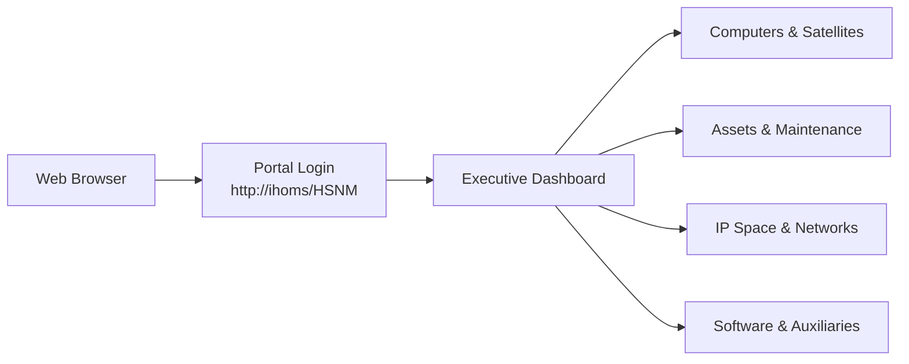
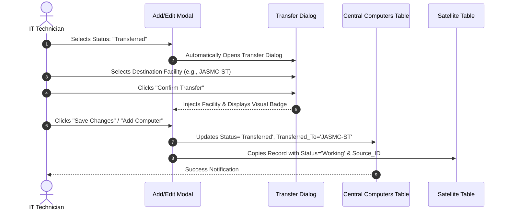
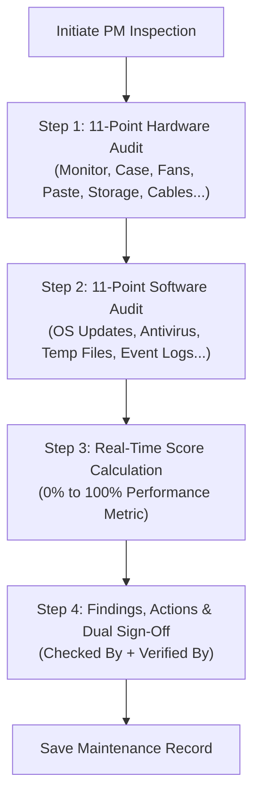

# Hardware & Security Network Management (HSNM)
## Official Operations & User Manual (SOP Manual)
**Version:** v1.15.6  
**Last Updated:** November 11, 2026  
**Target Audience:** Hospital IT Staff, Network Administrators, Property Custodians, and Technical Support Personnel  
**Web Portal:** `http://ihoms/HSNM` *(or `http://192.163.10.11/HSNM`)*

---

## Table of Contents
1. [Introduction & System Navigation](#1-introduction--system-navigation)
   - [1.1 Accessing the Portal](#11-accessing-the-portal)
   - [1.2 Executive Dashboard Overview](#12-executive-dashboard-overview)
2. [Authentication & Session Security](#2-authentication--session-security)
3. [Central Computer Inventory](#3-central-computer-inventory)
   - [3.1 Searching, Filtering & Pagination](#31-searching-filtering--pagination)
   - [3.2 Adding a New Computer](#32-adding-a-new-computer)
   - [3.3 Standard Operating Procedure: Transferring a Computer to a Satellite](#33-standard-operating-procedure-transferring-a-computer-to-a-satellite)
   - [3.4 Computer Lifecycle & Maintenance Status](#34-computer-lifecycle--maintenance-status)
   - [3.5 Excel & CSV Exporting & Printing](#35-excel--csv-exporting--printing)
   - [3.6 Bulk CSV Importing](#36-bulk-csv-importing)
4. [Multi-Facility Satellite Management (JASMC-ST, JASMC-VT, DOH-JBL-CMC)](#4-multi-facility-satellite-management-jasmc-st-jasmc-vt-doh-jbl-cmc)
   - [4.1 Satellite Workstation Inventories](#41-satellite-workstation-inventories)
   - [4.2 Satellite IP Address Inventories](#42-satellite-ip-address-inventories)
   - [4.3 Cross-Facility Top Switcher Tabs](#43-cross-facility-top-switcher-tabs)
5. [Capital Asset Inventory Management](#5-capital-asset-inventory-management)
   - [5.1 One-Click Computer to Asset Synchronization](#51-one-click-computer-to-asset-synchronization)
   - [5.2 Managing Property Assets & Financial Valuation](#52-managing-property-assets--financial-valuation)
   - [5.3 Printing Official Computer Unit Inventory Forms](#53-printing-official-computer-unit-inventory-forms)
6. [Preventive Maintenance (PM) Checklist & Inspection](#6-preventive-maintenance-pm-checklist--inspection)
   - [6.1 Conducting a 22-Point Digital Audit](#61-conducting-a-22-point-digital-audit)
   - [6.2 Real-Time Health Scoring & Findings](#62-real-time-health-scoring--findings)
   - [6.3 Printing Official PM Inspection Certificates](#63-printing-official-pm-inspection-certificates)
7. [IP Address Management & Diagnostic Scanners](#7-ip-address-management--diagnostic-scanners)
   - [7.1 Single & Batch Ping Diagnostics](#71-single--batch-ping-diagnostics)
   - [7.2 Non-ICMP Discovery (ARP & MAC Scanning)](#72-non-icmp-discovery-arp--mac-scanning)
8. [Reconciliation: Compare & Sync Engine](#8-reconciliation-compare--sync-engine)
9. [Software Licensing: Microsoft Office Tracking](#9-software-licensing-microsoft-office-tracking)
10. [Network Infrastructure & Endpoint Security](#10-network-infrastructure--endpoint-security)
11. [Hospital Auxiliaries (Printers, PABX, Queueing TV, ICS, Links)](#11-hospital-auxiliaries-printers-pabx-queueing-tv-ics-links)
12. [Reports, Audit Logs & System Changelog](#12-reports-audit-logs--system-changelog)
13. [Administrator Guide: User Management & Cloud Data Sync 2.0](#13-administrator-guide-user-management--cloud-data-sync-20)
14. [Troubleshooting & Frequently Asked Questions (FAQ)](#14-troubleshooting--frequently-asked-questions-faq)

---

## 1. Introduction & System Navigation

The **Hardware & Security Network Management (HSNM)** platform unifies IT infrastructure tracking, physical hardware custody, network IP allocation, and preventive maintenance compliance across the central hospital and its affiliated satellite healthcare facilities.



### 1.1 Accessing the Portal
1. Open Google Chrome, Microsoft Edge, or Mozilla Firefox.
2. In the URL address bar, enter:
   ```
   http://ihoms/HSNM
   ```
   *(If your workstation has not yet acquired the local DNS settings, use `http://192.163.10.11/HSNM`).*

### Interface Layout
- **Left Navigation Sidebar**: Contains categorized links to all authorized modules. The bottom includes a **Theme Toggle** (Dark / Light mode) and your user profile with the current version badge (`v1.15.6`).
- **Top Control Bar**: Provides action buttons (Add Record, Export Excel, Export CSV, Import CSV, Print) alongside summary KPI cards.
- **Search & Filter Bar**: Real-time keyword filter and dropdown selectors for status, department, and sort order.
- **Data Table**: Features sticky header columns, 15 records per page default pagination, interactive status badges, and action toolbars.

### 1.2 Executive Dashboard Overview
The central dashboard (`/`) acts as the operations command center:
- **Top Metrics Ribbon**: Real-time summary of Total Tracked Endpoints, Hospital IP Allocation percentage, Total Satellite Units deployed, and System Sync Integrity status.
- **Isolated Query Resilience**: Metric counts run in isolated evaluation blocks, ensuring that temporary modifications or single-table maintenance tasks never cascade or zero out other dashboard cards.
- **Central Computers Card**: Total workstations with categorized status counts (`Working`, `Maintenance`, `Transferred`, `Condemned`).
- **Satellite Hospital Inventories Hub**: Interactive facility cards linking directly to:
  - **JASMC &mdash; Sto. Tomas (`JASMC-ST`)**
  - **JASMC &mdash; Victoria Tarlac (`JASMC-VT`)**
  - **DOH-JBL Children's Medical Center (`DOH-JBL-CMC`)**
- **Asset Inventory Card**: Active equipment count and total capital procurement valuation in Philippine Pesos (₱).
- **Preventive Maintenance Card**: Total digital inspections conducted, average fleet health score (%), and flagged units requiring corrective action.
- **Quick Action Shortcuts**: Fast 1-click dialogs to schedule PM audits, register assets, add workstations, or verify data synchronization.

---

## 2. Authentication & Session Security

### 2.1 Logging In
1. Navigate to `http://ihoms/HSNM/login`.
2. Enter your assigned **Username** and **Password**.
3. Click **Sign In**.
4. Upon validation, your role and permitted modules are loaded into your session, and you are routed to the Executive Dashboard.

### 2.2 Session Security & Timeout
- **30-Minute Idle Timeout**: To comply with healthcare information security standards, inactive sessions expire after 30 minutes. You will be redirected to the login screen with an expiration alert.
- **Anti-Caching Protection**: Browsers are prohibited from storing authenticated pages in disk cache; clicking "Back" after logout will never expose sensitive patient area equipment details.

### 2.3 Logging Out
Always log out before stepping away from your terminal:
1. Locate your user card at the bottom of the left sidebar.
2. Click the red **Logout** button.
3. The server immediately invalidates your session cookie.

---

## 3. Central Computer Inventory

Accessible via **Sidebar → Computers** (`/modules/computers/`).

### 3.1 Searching, Filtering & Pagination
- **Live Search**: Type into the search input box. Workstations matching the user name, control number, serial number, IP address, or MAC address filter dynamically. **MAC addresses can be searched using either colon (`00:1A:2B:3C:4D:5E`) or hyphen (`00-1A-2B-3C-4D-5E`) notation** — the system normalizes the format automatically.
- **Status Filter**:
  - `All Status` (Displays all records)
  - `Working` (Workstations active in headquarters)
  - `Maintenance` (Units currently in repair or undergo PMS)
  - `Transferred` (Units relocated to satellite branches)
  - `Condemned` (Decommissioned or scrap units)
- **Rows Per Page**: Defaulted to **15** rows per page for rapid loading. Expandable to 50, 100, or All rows.

---

### 3.2 Adding a New Computer
1. Click **+ Add Computer** in the top right.
2. Fill out the sectioned modal:
   - **General Information**: Select Building, Floor, enter Department, End User full name, MR/PAR number, and unique Control Number.
   - **Status**: Choose `Working` or `Maintenance`.
   - **System Unit**: Enter Brand/Model (*e.g., Lenovo ThinkCentre M70q*) and Serial Number.
   - **Core Specs**: Specify Processor (*e.g., Intel Core i7-11700*), RAM Memory (*e.g., 16GB DDR4*), and Storage (*e.g., 512GB NVMe SSD*).
   - **Peripherals**: Enter Monitor model/serial, Keyboard/Mouse, and select assigned Printers, Scanners, and AVR/UPS units.
   - **Software & Licenses**: Choose Operating System, enter OS Key, License status, and Microsoft Office details.
   - **Network & Security**: Assign static IP address, physical MAC address, Endpoint Secure status, and Firewall compliance.
   - **Personnel**: Select **Encoded By** and **Checked By**, audit date, and remarks.
3. Click **Add Computer**.
4. **Automatic Real-Time Sync**: The new machine is automatically copied into the **Asset Registry** via the background `syncComputerToAsset()` hook.

---

### 3.3 Standard Operating Procedure: Transferring a Computer to a Satellite

When equipment is physically relocated from headquarters to an external branch facility:



#### Step-by-Step Instructions:
1. Locate the computer in the table and click its **Control Number** or **Edit (✏️)**.
2. In **General Information**, change **Status** to **`Transferred`**.
3. The **Transfer Computer** modal dialog opens immediately:
   - Select the target facility:
     - **`JASMC-ST`** (JASMC &mdash; Sto. Tomas)
     - **`JASMC-VT`** (JASMC &mdash; Victoria Tarlac)
     - **`DOH-JBL-CMC`** (DOH-JBL Children's Medical Center)
   - Click **Confirm Transfer**.
4. A yellow badge confirms the destination:
   ```
   → Transferred to: JASMC-ST
   ```
5. Click **Save Changes**.
6. **Automated Cross-Table Replication**:
   - The headquarters record is updated to `Transferred` with a blue badge.
   - An exact clone of the workstation specification is created in the satellite's database table (`computers_jasmc_st`).
   - At the satellite site, the record is initialized as **`Working`** and linked back to its original `source_computer_id`.

> [!NOTE]
> If you click **Cancel** on the Transfer Dialog, the status reverts to **`Working`** to prevent accidental misclassification.

---

### 3.4 Computer Lifecycle & Maintenance Status
Workstations can now be explicitly placed into **`Maintenance`** status:
- Use this when a computer is temporarily removed from service for hardware replacement, OS reinstallation, or preventive maintenance.
- In the Asset Registry, computers flagged as `Maintenance` or `Transferred` automatically update to their corresponding lifecycle state.

---

### 3.5 Excel & CSV Exporting & Printing
- **Export All to Excel**: Generates a formatted OpenXML `.xlsx` spreadsheet with styled headers and column widths.
- **Export Selected Rows**: Check row checkboxes and click **Export CSV**.
- **Print Roster**: Opens the browser print preview with sidebars and action chrome hidden.

---

### 3.6 Bulk CSV Importing
1. Click **Import CSV**.
2. Download the CSV template to verify expected header columns.
3. Select your `.csv` file and click **Upload & Import**.
4. The system validates unique control numbers and imports valid rows with duplicate warnings.

---

## 4. Multi-Facility Satellite Management (JASMC-ST, JASMC-VT, DOH-JBL-CMC)

HSNM provides dedicated subsystems for each affiliated health facility:
- **JASMC-ST**: Sto. Tomas Branch
- **JASMC-VT**: Victoria Tarlac Branch
- **DOH-JBL-CMC**: Children's Medical Center

### 4.1 Satellite Workstation Inventories
- Located in sidebar under **Computers**:
  - ↳ **JASMC-ST** (`/modules/jasmc_st/`)
  - ↳ **JASMC-VT** (`/modules/jasmc_vt/`)
  - ↳ **DOH-JBL-CMC** (`/modules/doh_jbl_cmc/`)
  - ↳ 🤝 **Outsourced** (`/modules/outsourced/`)
- Each branch maintains an independent database table (`computers_jasmc_st`, `computers_jasmc_vt`, `computers_doh_jbl_cmc`).
- The **Outsourced** module filters the central `computers` table by `JBL-OS-` control number prefix — no separate DB table is used.
- Satellite technicians can add local purchases directly or manage equipment transferred from headquarters.
- **Filter Dropdowns Auto-Apply**: In the JASMC-ST, JASMC-VT, and DOH-JBL-CMC satellite modules, the **Status**, **Sort**, and **Show** (rows per page) dropdowns now apply immediately on selection — no need to click the "Filter" button separately.

### 4.2 Satellite IP Address Inventories
- Located in sidebar under **IP Addresses**:
  - ↳ **JASMC-ST** (`/modules/ips_jasmc_st/`)
  - ↳ **JASMC-VT** (`/modules/ips_jasmc_vt/`)
  - ↳ **DOH-JBL-CMC** (`/modules/ips_doh_jbl_cmc/`)
  - ↳ 🤝 **Outsourced IPs** (`/modules/ips_outsourced/`)
- Tracks local static IP allocations, MAC addresses, device types, and departments at each remote facility.
- The **Outsourced IPs** module filters the main `ips` table by `JBL-OS-` control number prefix.

### 4.3 Cross-Facility Top Switcher Tabs
Both Computer and IP modules feature unified top navigation tabs (`satellite_computer_tabs.php` and `satellite_ip_tabs.php`):
- Switch between **Hospital (Main)**, **JASMC-ST**, **JASMC-VT**, **DOH-JBL-CMC**, and **Outsourced** with 1 click.
- Each tab displays a live, real-time counter pill showing total registered units.
- The **Main** IP tab counter includes all records (including JBL-OS- outsourced records). The **Outsourced** tab shows only the JBL-OS- subset.

---

## 4a. Outsourced / Donated Equipment Inventories

The **Outsourced** modules track equipment and IP addresses managed by external service providers or received through donation/outsourcing arrangements. These records are identified by the `JBL-OS-` control number prefix.

### Accessing Outsourced Computers
1. Click **Computers → Outsourced** in the sidebar, or click the **Outsourced** tab in the top switcher bar.
2. URL: `http://ihoms/HSNM/modules/outsourced/`
3. The list shows all computers from the central `computers` table whose control number starts with `JBL-OS-`.

### Accessing Outsourced IPs
1. Click **IP Addresses → Outsourced IPs** in the sidebar, or click the **Outsourced** tab in the IP switcher bar.
2. URL: `http://ihoms/HSNM/modules/ips_outsourced/`
3. The list shows all IP records from the `ips` table whose control number starts with `JBL-OS-`.

### Understanding the `JBL-OS-` Prefix
- `JBL-OS-` stands for **JBL Outsourced** — it identifies equipment not owned by the hospital but tracked within the inventory system.
- The prefix is **auto-enforced**: the control number field in the Add and Edit forms is pre-filled with `JBL-OS-` and cannot be removed.
- Server-side PHP also validates the prefix before saving, rejecting any submission that does not conform.
- The `JBL-OS-` filter is intentionally strict and **excludes** other similarly-prefixed namespaces (e.g., `JBL-OSM-`).

### Adding a New Outsourced Record
1. Click **+ Add Computer** (or **+ Add IP**) in the respective Outsourced module.
2. The **Control Number** field is pre-filled with `JBL-OS-`. Type the rest of the identifier after the prefix (e.g., `JBL-OS-HS-PC005`).
3. Fill in all other fields as normal.
4. Click **Add**. The record is saved in the shared `computers` or `ips` table and will appear in both the Outsourced module and the main inventory.

### Exporting Outsourced Records
- **Export Excel / Export CSV** in the Outsourced modules are **scoped to `JBL-OS-%` records only** — exports will not include non-outsourced equipment.
- To export the full inventory including outsourced records, use the main **Computers** or **IP Addresses** module export instead.

---

## 5. Capital Asset Inventory Management

Accessible via **Sidebar → Asset Inventory** (`/modules/assets/`).

Manages capital equipment, property valuations, and Property Transfer Receipts (PTR).

### 5.1 One-Click Computer to Asset Synchronization
To import or refresh all central computer records into the Asset Registry:
1. Navigate to **Asset Inventory**.
2. Click the blue **Sync Computers** button in the header bar.
3. The **Computers &rarr; Assets &amp; Maintenance Migration Runner** opens:
   - Displays real-time counts of source computers (872), current assets, and PMS records (574).
   - Check **Seed Historical PM Audits** to link historical inspections.
4. Click **Execute One-Click Sync**.
5. The runner executes transactional upserts (`ON CONFLICT (control_id) DO UPDATE`), updating hardware specifications while preserving manually entered financial costs and PTR numbers.

### 5.2 Managing Property Assets & Financial Valuation
1. Click **+ Add Asset** to manually register non-workstation assets or specialized medical IT gear.
2. Enter **Control ID**, **PTR Number**, **Item Code**, **Procurement Source** (*Purchased*, *Donated*, *Transferred*), and acquisition **Cost (PHP)**.
3. On any row, click the **Wrench (🔧)** icon to launch a new Preventive Maintenance inspection with asset details pre-filled.

### 5.3 Printing Official Computer Unit Inventory Forms
1. Select one or more assets using the row checkboxes (or click Print on an individual row).
2. Click **Print Form** (`/modules/assets/print.php`).
3. The system renders an official government/hospital formatted Computer Unit Inventory Sheet ready for signature and filing.

---

## 6. Preventive Maintenance (PM) Checklist & Inspection

Accessible via **Sidebar → Maintenance** (`/modules/maintenance/`).

HSNM digitizes hospital IT preventive maintenance with a 22-point audit.



### 6.1 Conducting a 22-Point Digital Audit
1. Click **+ New Inspection**.
2. Select the **Asset** or **Computer** being inspected.
3. Complete the **11-Point Hardware Checklist** (Pass / Fail / N/A):
   - Monitor Display & Casing Cleanliness
   - System Unit Interior (Dust/Debris)
   - Keyboard Key Action
   - Mouse Tracking & Buttons
   - Storage Drive S.M.A.R.T. Health
   - Cable Routing & Condition
   - Power Supply & AVR Output Voltage
   - Cooling Fans & Airflow
   - CPU Thermal Paste Integrity
   - Physical Casing & Screws
   - USB, Audio & Network Ports
4. Complete the **11-Point Software Checklist** (Pass / Fail / N/A):
   - Operating System Security Patches
   - Antivirus Definitions Up-to-Date
   - Antivirus Full System Scan Completed
   - Temporary Files Cleaned
   - Disk Defragmentation / TRIM Performed
   - Startup Programs Optimized
   - Browser Cache Cleared
   - Unauthorized Software Removed
   - Windows Firewall Active
   - Critical Data Backup Verified
   - Event Viewer Error Logs Inspected

### 6.2 Real-Time Health Scoring & Findings
- The real-time meter updates automatically as you check boxes:
  - **90% – 100%**: Optimal Health (Green badge)
  - **75% – 89%**: Satisfactory / Routine Attention (Yellow badge)
  - **Below 75%**: Needs Action / Critical Attention (Red badge)
- Document **Environmental Observations**, **Actions Taken**, and **Recommendations**.
- Enter **Checked By** (Technician) and **Verified By** (Supervisor).
- Click **Save Inspection Report**.

### 6.3 Printing Official PM Inspection Certificates
1. Check the box next to one or more completed maintenance records.
2. Click **Print Checklist** (`/modules/maintenance/print.php`).
3. The system renders the official **Computer Preventive Maintenance Checklist** form complete with individual checkmarks, performance score, technician findings, and signature blocks.

---

## 7. IP Address Management & Diagnostic Scanners

Accessible via **Sidebar → IP Addresses** (`/modules/ips/`).

### 7.1 Single & Batch Ping Diagnostics
- **Single Ping**: Click the **Ping (⚡)** button on any row. An interactive modal sends ICMP packets, reports round-trip latency, updates online status, and resolves the NetBIOS hostname.
- **Batch Ping**:
  1. Check multiple rows.
  2. Click **Batch Ping** in the control bar.
  3. The system concurrently pings the selected IP pool and updates hostnames and statuses in the database.

### 7.2 Non-ICMP Discovery (ARP & MAC Scanning)
If client firewalls block ICMP echo packets:
- HSNM automatically invokes ARP, NBTSTAT, and GETMAC scrapers.
- If an active MAC address or NetBIOS responder is detected, the device is flagged as **Active** even if ping returns no response.

---

## 8. Reconciliation: Compare & Sync Engine

Accessible via **Sidebar → Compare & Sync** (`/modules/reconciliation/`).

Identifies discrepancies between physical **Computers** and network **IP Addresses**:
- **Data Mismatches**: Devices sharing a `control_number` but having diverging IP or MAC addresses.
  - Click **Sync to IP** to push computer records into IP space.
  - Click **Sync to Computer** to pull verified IP records into computer inventory.
- **Identity Conflicts**: Two different control numbers claiming the exact same IP or MAC.

---

## 9. Software Licensing: Microsoft Office Tracking

Accessible via **Sidebar → MS Office** (`/modules/office/`).
- Tracks Office 2016, 2019, 2021, and Microsoft 365 ProPlus licenses.
- Associates license keys with departmental login emails (`@hospital.gov.ph`).
- Workstations with Office details entered in the Computer module are synchronized here automatically.

---

## 10. Network Infrastructure & Endpoint Security

- **Routers (`/modules/routers/`)**: Tracks edge routers, LAN/WAN gateways, SSID, and admin passwords.
- **Switches (`/modules/switches/`)**: Tracks switch models, port density, management IPs, and rack locations.
- **Firewall Compliance (`/modules/firewall/`)**: Monitors antivirus agent installation and Windows Firewall status across workstations.

---

## 11. Hospital Auxiliaries (Printers, PABX, Queueing TV, ICS, Links)

- **Printers (`/modules/printers/`)**: Standalone printer inventory tracking toner models and serial numbers.
- **PABX Directory (`/modules/pabx/`)**: Hospital telephone extension directory with fast search by name, department, or floor.
- **Queueing TV (`/modules/queueing_tv/`)**: Manages TV display displays and queue numbering for outpatient lobbies.
- **ICS Inventory (`/modules/ics/`)**: Generates and prints official Inventory Custodian Slips for tangible property.
- **iHOMS Links (`/modules/ihoms_links/`)**: Central bookmark launchpad for internal medical portals and lab systems.

---

## 12. Reports, Audit Logs & System Changelog

- **Reports (`/modules/reports/`)**: Cross-tabular analytics by department, building, floor, and hardware specs.
- **Audit Logs (`/modules/logs/`)**: Complete audit trail showing who made changes, the exact before-and-after diffs, and IP addresses.
- **Changelog (`/modules/changelog/`)**: Displays active system version (`v1.15.6`) and tracks codebase modifications using MD5 checksum scans.

---

## 13. Administrator Guide: User Management & Cloud Data Sync 2.0

### 13.1 User Management & Permission Checkboxes
*(Restricted to Admin role)*
1. Navigate to **Sidebar → Settings** (`/modules/settings/`).
2. Click **Add User** or **Edit** on an existing user.
3. Check the specific modules the user is authorized to access.
4. Save the user. Permissions are applied instantly on their next page load.

### 13.2 Cloud Data Synchronization Protocol (`sync_neon.php`)
1. Click **Data Sync** in the sidebar.
2. Review the 22-table comparison summary (Local vs. Neon Cloud records).
3. If syncing deletions, check **Allow Deletion Sync**.
4. Click **Execute Synchronization**.
5. The engine executes schema checks, column type intersections, match-key updates, and deletion reconciliation with live terminal logs.

---

## 14. Troubleshooting & Frequently Asked Questions (FAQ)

### Q1: Workstations cannot resolve `http://ihoms/HSNM`
**Solution**:
1. Verify the client PC has DNS set to `192.163.10.11`.
2. On the server, restart Acrylic DNS Proxy:
   ```powershell
   Restart-Service -Name "AcrylicDNSProxySvc"
   ```
3. Ensure Windows Firewall allows incoming UDP/TCP port 53.
4. Immediate workaround: Open `http://192.163.10.11/HSNM`.

### Q2: I marked a computer as "Transferred", but the status went back to "Working"
**Explanation**:
- If you cancel or close the Transfer Dialog without picking a destination facility (`JASMC-ST`, `JASMC-VT`, `DOH-JBL-CMC`), the system reverts the status to `Working` to protect against orphaned records.

### Q3: A computer is powered on, but ICMP Ping reports "Offline"
**Explanation**:
- Windows Firewall on client machines blocks ICMP echo packets by default.
- Click **Scan MAC / ARP** in the IP Address module to verify if the machine responds via ARP or NetBIOS.
