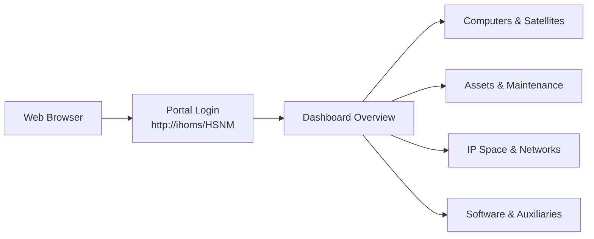
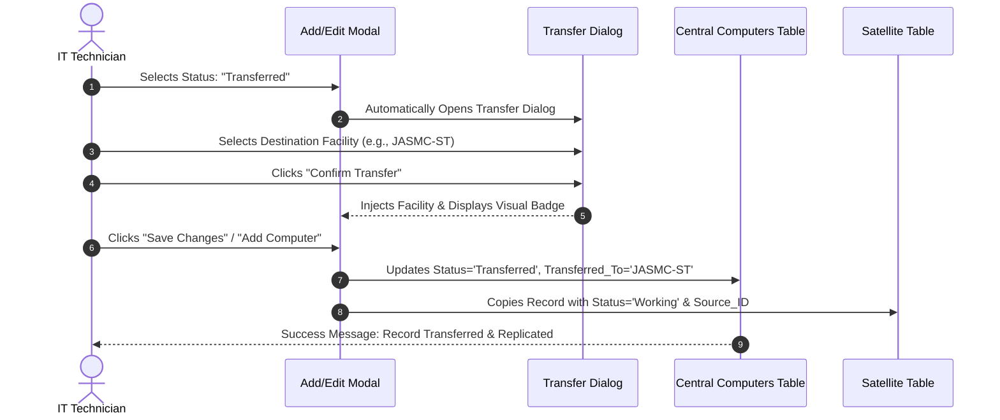
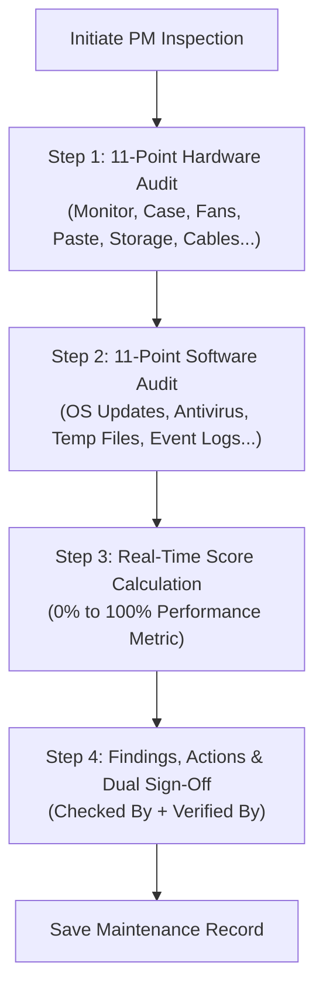

# Hardware & Security Network Management (HSNM)
## Official Operations & User Manual (SOP Manual)
**Version:** v1.15.4  
**Target Audience:** Hospital IT Staff, Network Administrators, Property Custodians, and Technical Support Personnel  
**Web Portal:** `http://ihoms/HSNM` *(or `http://192.163.10.11/HSNM`)*

---

## Table of Contents
1. [Introduction & System Navigation](#1-introduction--system-navigation)
   - [1.1 Executive Dashboard Overview](#11-executive-dashboard-overview)
2. [Authentication & Session Security](#2-authentication--session-security)
3. [Central Computer Inventory](#3-central-computer-inventory)
   - [3.1 Viewing, Searching & Filtering](#31-viewing-searching--filtering)
   - [3.2 Adding a New Computer](#32-adding-a-new-computer)
   - [3.3 Standard Operating Procedure: Transferring a Computer to a Satellite](#33-standard-operating-procedure-transferring-a-computer-to-a-satellite)
   - [3.4 Editing & Updating Computer Details](#34-editing--updating-computer-details)
   - [3.5 Excel & CSV Exporting & Printing](#35-excel--csv-exporting--printing)
   - [3.6 Bulk CSV Importing](#36-bulk-csv-importing)
4. [Satellite Facility Modules (JASMC-ST, JASMC-VT, DOH-JBL-CMC)](#4-satellite-facility-modules-jasmc-st-jasmc-vt-doh-jbl-cmc)
5. [Asset Inventory Management](#5-asset-inventory-management)
6. [Preventive Maintenance (PM) Checklist & Inspection](#6-preventive-maintenance-pm-checklist--inspection)
7. [IP Address Management & Diagnostic Scanners](#7-ip-address-management--diagnostic-scanners)
8. [Reconciliation: Compare & Sync Engine](#8-reconciliation-compare--sync-engine)
9. [Software Licensing: Microsoft Office Tracking](#9-software-licensing-microsoft-office-tracking)
10. [Network Infrastructure & Peripherals](#10-network-infrastructure--peripherals)
11. [Reports, Audit Logs & System Changelog](#11-reports-audit-logs--system-changelog)
12. [Administrator Guide: User Management & Cloud Data Sync](#12-administrator-guide-user-management--cloud-data-sync)
13. [Troubleshooting & Frequently Asked Questions (FAQ)](#13-troubleshooting--frequently-asked-questions-faq)

---

## 1. Introduction & System Navigation

The **Hardware & Security Network Management (HSNM)** platform centralizes the tracking, maintenance, and networking of IT assets across the central hospital and affiliated satellite healthcare facilities.



### Accessing the System
1. Open any modern web browser (Google Chrome, Microsoft Edge, or Mozilla Firefox).
2. In the address bar, type:
   ```
   http://ihoms/HSNM
   ```
   *(If your workstation has not yet acquired the local DNS settings, use `http://192.163.10.11/HSNM`).*

### Interface Layout
- **Left Sidebar**: Primary navigation menu grouping all authorized modules. The bottom of the sidebar features a **Theme Switcher** (Dark / Light mode) and your user profile with the current application version (`v1.15.3`).
- **Top Control Bar**: Displays contextual action buttons (Add, Export, Import, Print) and real-time summary statistics cards.
- **Search & Filter Row**: Fast keyword filter, dropdown selectors for status, department, and sort order.
- **Data Table**: Tabular view featuring sticky controls, status badges, clickable control numbers, and action icons.

### 1.1 Executive Dashboard Overview
The central dashboard (`/`) acts as the command center for hospital IT operations:
- **Top Metrics Ribbon**: Real-time snapshot of Total Tracked Devices, Network IP Allocation percentage, Satellite Units deployed, and System Sync Integrity status.
- **Infrastructure & Lifecycle Cards**:
  - **Computers**: Total units with inline status metrics (`Working`, `Transferred`, `Condemned`) and satellite breakdown (`ST`, `VT`, `JBL`).
  - **Asset Inventory**: Total physical equipment count, active count, and total acquisition valuation (₱).
  - **Preventive Maintenance (PM)**: Total audits, average system health score (%), and pending action items.
  - **Compare & Sync**: Cross-referencing discrepancies between IP allocations and physical workstations.
  - **Network & Peripherals**: Gateways (Routers), distribution switchgear (Switches), IP address pools, Office licenses, Printers, Queueing TVs, ICS items, and PABX directory.
- **Satellite Hospital Inventories Hub**: Dedicated interactive cards for external facilities:
  - **JASMC &mdash; Sto. Tomas (`JASMC-ST`)**
  - **JASMC &mdash; Victoria Tarlac (`JASMC-VT`)**
  - **DOH-JBL Children's Medical Center (`DOH-JBL-CMC`)**
- **Quick Action Shortcuts**: 1-click modals and redirection to schedule PM, add assets, register computers, deploy IPs, or trigger synchronization checks.
- **Recent Activity Stream**: Live audit trail logging administrator and staff modifications.

---

## 2. Authentication & Session Security

### 2.1 Logging In
1. Navigate to the login portal.
2. Enter your assigned **Username** and **Password**.
3. Click **Sign In**.
4. Upon successful validation, you are redirected to the Executive Dashboard.

### 2.2 Session Inactivity Timeout
For security compliance, sessions automatically expire after **30 minutes of inactivity**. If your session expires:
1. The system locks out any further modifications.
2. You will be redirected back to the login screen with an expiration alert.
3. Simply log back in to resume your tasks.

### 2.3 Logging Out
Always log out before leaving your workstation:
1. Locate your user avatar card at the bottom of the left sidebar.
2. Click the red **Logout (exit)** button.
3. The session is immediately destroyed on the server, and browser caching is purged.

---

## 3. Central Computer Inventory

Accessible via **Sidebar → Computers** (`/modules/computers/`).

### 3.1 Viewing, Searching & Filtering
- **Live Search**: Type any string (user name, control number, IP address, MAC, or serial number) into the search box. The table filters automatically without a full page reload.
- **Status Filter**: Use the Status dropdown to filter by:
  - `All Status` (Shows all records)
  - `Working` (Machines currently active in the central hospital)
  - `Transferred` (Machines relocated to satellite facilities)
  - `Condemned` (Decommissioned or scrapped machines)
- **Rows Per Page**: Toggle between 15, 50, 100, or All records per page.

---

### 3.2 Adding a New Computer
1. Click the **+ Add Computer** button in the top right.
2. Complete the sectioned form:
   - **General Information**: Select Building, Floor, enter Department/Section, End User full name, MR/PAR number, and unique Control Number.
   - **System Unit**: Enter Brand/Model (e.g. *HP ProDesk 400 G6*) and System Unit Serial Number.
   - **Core Hardware Specifications**: Specify Processor (*e.g. Intel Core i5-10500*), RAM Memory (*e.g. 16GB DDR4*), and Storage (*e.g. 512GB NVMe SSD*).
   - **Peripheral Components**: Enter Monitor brand and serial number, Mouse, Keyboard, and select any assigned Printers, Scanners, or AVR/UPS units.
   - **System & Software**: Select Operating System, enter OS Product Key, License status (Yes/No), Microsoft Office version, and account email.
   - **Network & Security**: Enter assigned static IP address, MAC address, Endpoint Secure status, and Firewall status.
   - **Personnel & Remarks**: Select your name in **Encoded By** and **Checked By**, enter the date, and any relevant remarks.
3. Click **Add Computer** to save.

---

### 3.3 Standard Operating Procedure: Transferring a Computer to a Satellite

When a workstation is physically transferred from the central hospital to an external or satellite health facility, execute the following protocol:



#### Step-by-Step Instructions:
1. Locate the computer in the table and click its **Control Number** or the **Edit (✏️)** button.
2. In the **General Information** section, change the **Status** dropdown to **`Transferred`**.
3. A modal popup titled **Transfer Computer** will appear immediately:
   - Select the destination facility from the dropdown:
     * **`JASMC-ST`** (JASMC — Sto. Tomas)
     * **`JASMC-VT`** (JASMC — Victoria Tarlac)
     * **`DOH-JBL-CMC`** (DOH-JBL Children's Medical Center)
   - Click **Confirm Transfer**.
4. A yellow badge will appear below the status dropdown:
   ```
   → Transferred to: JASMC-ST
   ```
5. Click **Save Changes** at the bottom of the modal.
6. **System Automation Triggered**:
   - The central record is marked `Transferred` with a blue badge.
   - A complete clone of the machine is created in the destination satellite table (`computers_jasmc_st`).
   - In the satellite table, the computer is initialized with status **`Working`** and linked back to its source ID.

> [!NOTE]
> If you click **Cancel** on the Transfer Dialog, the status dropdown automatically reverts back to **`Working`** to prevent accidental misclassification.

---

### 3.4 Editing & Updating Computer Details
1. Click the **Control Number** (blue text) or click the **Edit (✏️)** icon on any row.
2. Modify any field in the sectioned form.
3. Ensure **Checked By** and **Encoded By** are filled out.
4. Click **Save Changes**. The audit log automatically records a field-by-field diff of what was changed.

---

### 3.5 Excel & CSV Exporting & Printing
- **Export All to Excel**: Click **Export Excel**. The system downloads an formatted `.xlsx` spreadsheet with colored headers, column widths, and location dropdowns.
- **Export Selected Rows**: Check the boxes on specific rows, then click **Export CSV**. Only the selected rows will be exported.
- **Print Roster**: Click **Print** to open the browser print dialog. The print stylesheet strips sidebars, buttons, and dark backgrounds, formatting the roster for standard letter/legal landscape printing.

---

### 3.6 Bulk CSV Importing
To upload existing computer spreadsheets:
1. Click **Import CSV**.
2. Download the template if needed to verify your column headers.
3. Choose your `.csv` file and click **Upload & Import**.
4. The system validates uniqueness on `control_number` and imports all valid rows.

---

## 4. Satellite Facility Modules (JASMC-ST, JASMC-VT, DOH-JBL-CMC)

Located in the sidebar directly beneath **Computers**:
- ↳ **JASMC-ST** (`/modules/jasmc_st/`) &mdash; JASMC &mdash; Sto. Tomas
- ↳ **JASMC-VT** (`/modules/jasmc_vt/`) &mdash; JASMC &mdash; Victoria Tarlac
- ↳ **DOH-JBL-CMC** (`/modules/doh_jbl_cmc/`) &mdash; DOH-JBL Children's Medical Center

### Satellite Operations
1. **Dedicated Database**: Each satellite operates its own inventory table separate from headquarters.
2. **Reviewing Transferred Units**: Machines transferred from headquarters appear here with their original specifications and a link to the central computer record.
3. **Local Additions**: Satellite IT technicians can click **+ Add Computer** to register locally purchased or branch-specific equipment directly at their site.
4. **Independent Export & Print**: Each satellite has its own Excel/CSV export and print features.

---

## 5. Asset Inventory Management

Accessible via **Sidebar → Asset Inventory** (`/modules/assets/`).

The Asset Inventory manages capital equipment, property valuations, and Property Transfer Receipts (PTR).

### 5.1 One-Click Computer to Asset Synchronization
To import or refresh all central computer inventory units into the Asset Registry:
1. Navigate to **Asset Inventory**.
2. Click the blue **Sync Computers** button in the header bar (positioned immediately before **Export Excel**).
3. The **Computers &rarr; Assets &amp; Maintenance Migration Runner** opens:
   - Displays real-time counts of source computers (872), current registered assets, and detected PMS historical records (574).
   - Summarizes transformation rules (unique `control_id` resolution, combined keyboard/mouse, boolean license mapping, and status translation).
   - Check the **Seed Historical PM Audits** option (checked by default) to automatically import 574 historical PMS audit records into Maintenance with foreign key linkage.
4. Click **Execute One-Click Sync**.
5. The pipeline processes in milliseconds using transactional conflict resolution (`ON CONFLICT (control_id) DO UPDATE`), preserving any manually entered costs or PTR numbers while updating technical specs.
6. **Automatic Real-Time Sync**: Any new computer added or modified in the Computer Inventory is also automatically synchronized to the Asset Registry in real time via the `syncComputerToAsset()` system hook.

### 5.2 Managing Property Assets
1. **Adding an Asset Manually**:
   - Click **+ Add Asset**.
   - Input the **Control ID**, **Item Code**, **PTR Number**, **Procurement Source** (*Purchased*, *Donated*, *Transferred*), and acquisition **Cost (PHP)**.
   - Enter hardware specifications, dedicated **GPU**, monitor, printer, and power protection details.
   - Save the record.
2. **Launching Preventive Maintenance (🔧)**:
   - On any asset row, click the **Wrench (🔧)** icon under Actions.
   - The system immediately opens the Preventive Maintenance module with the asset's control number, department, and specifications pre-filled.
3. **Exporting Assets**:
   - Click **Export Excel** for formatted SpreadsheetML `.xlsx` reports with dropdown validations.
   - Click **Export CSV** for lightweight tabular exports.

---

## 6. Preventive Maintenance (PM) Checklist & Inspection

Accessible via **Sidebar → Maintenance** (`/modules/maintenance/`).

HSNM replaces physical maintenance log sheets with a digital 22-point audit.



### Performing a PM Inspection:
1. Click **+ New Inspection**.
2. Select the **Asset** or **Computer** being inspected.
3. Complete the **11-Point Hardware Inspection**:
   - For each item, select **Pass**, **Fail**, or **N/A**:
     * Monitor Display & Casing Cleanliness
     * System Unit Interior (Dust/Debris)
     * Keyboard Key Action
     * Mouse Tracking & Buttons
     * Storage Drive S.M.A.R.T. Health Status
     * Cable Condition & Cable Routing
     * Power Supply & AVR Output Voltage
     * Cooling Fans & Proper Airflow
     * CPU Thermal Paste Integrity
     * Physical Casing & Screws
     * USB, Audio & Network Port Conditions
4. Complete the **11-Point Software Inspection**:
   - For each item, select **Pass**, **Fail**, or **N/A**:
     * Operating System Security Patches
     * Antivirus Definitions Up-to-Date
     * Antivirus Full System Scan Completed
     * Temporary Files Cleaned
     * Disk Defragmentation / TRIM Performed
     * Startup Programs Optimized
     * Browser Cache Cleared
     * Unauthorized Software Removed
     * Windows Firewall Active
     * Backup Routine Verified
     * Event Viewer Error Log Inspected
5. **Review Score**: Watch the real-time **Performance Score** meter update. Scores above 90% indicate optimal health; scores below 75% flag the unit as *Needs Action*.
6. Document **Observations**, **Action Taken**, and future **Recommendations**.
7. Enter **Checked By** (Technician) and **Verified By** (Supervisor).
8. Click **Save Inspection Report**.

---

## 7. IP Address Management & Diagnostic Scanners

Accessible via **Sidebar → IP Addresses** (`/modules/ips/`).

### 7.1 Single & Batch Ping Diagnostics
- **Single Ping**: Click the **Ping (⚡)** button next to any IP address. A diagnostic modal opens, sending ICMP echo requests and returning latency times.
- **Batch Ping**:
  1. Check the checkboxes next to multiple IP addresses.
  2. Click **Batch Ping** in the top control bar.
  3. The system executes concurrent pings, retrieves NetBIOS hostnames, updates online/offline statuses in the database, and reloads the view.

### 7.2 Non-ICMP Discovery (ARP & MAC Scanning)
When Windows Firewall drops ping packets, HSNM's network engine automatically executes ARP, NBTSTAT, and GETMAC polling:
- If a physical MAC address responds, the system marks the device as **Active** even if ICMP ping is blocked.

---

## 8. Reconciliation: Compare & Sync Engine

Accessible via **Sidebar → Reconciliation** (`/modules/reconciliation/`).

Reconciliation automatically compares the physical **Computer Inventory** against network **IP Address Inventory** to identify drift.

### 8.1 Tabs & Issues Handled
1. **Data Mismatches**: Displays devices where the `control_number` matches, but the IP or MAC address in Computer Inventory does not match the IP module.
   - Click **Sync to IP** to push computer values into IP records.
   - Click **Sync to Computer** to pull verified IP records into computer inventory.
2. **Identity Conflicts**: Displays instances where two differing control numbers are claiming the exact same IP or MAC address.
   - Investigate the conflict and reassign or release the conflicting IP with one click.

---

## 9. Software Licensing: Microsoft Office Tracking

Accessible via **Sidebar → MS Office** (`/modules/office/`).

### Managing Office Licenses
1. **Tracking Editions**: Tracks Office 2016, 2019, 2021, and Microsoft 365 ProPlus licenses.
2. **Account Linking**: Connects each product key with the corresponding organizational Microsoft account email address (*@hospital.gov.ph*).
3. **Automated Sync**: Whenever an office suite and email are entered in the **Computer Inventory**, the record automatically synchronizes into this module.

---

## 10. Network Infrastructure & Peripherals

### 10.1 Routers & Switches (`/modules/routers/`, `/modules/switches/`)
- Catalogs core routers, branch edge routers, and managed switches.
- Records port densities, active uplinks, management IPs, and switch room rack locations.

### 10.2 Printers & PABX Directory (`/modules/printers/`, `/modules/pabx/`)
- **Printers**: Tracks network IP printers, shared USB printers, cartridge models, and departmental allocations.
- **PABX Directory**: Fast hospital telephone extension directory searchable by department or employee name.

### 10.3 Queueing TVs & ICS (`/modules/queueing_tv/`, `/modules/ics/`)
- **Queueing TV**: Tracks TV displays and mini-PCs powering patient queue numbering in OPD, ER, and waiting lobbies.
- **ICS Inventory**: Manages Inventory Custodian Slips for low-value tangible assets with custom printable slips.

---

## 11. Reports, Audit Logs & System Changelog

### 11.1 Reports Module (`/modules/reports/`)
- Generate cross-tabulation reports across departments, hardware specifications, and lifecycle statuses.
- Export filtered datasets directly to Excel or printable PDF format.

### 11.2 Audit Logs (`/modules/logs/`)
- Every record modification, addition, deletion, and satellite transfer is permanently recorded.
- Filter by Category (*Computer, IP, User, Reconciliation, System*) or search by technician username.
- View field-level diffs showing exactly what values were changed from old to new.

### 11.3 System Changelog (`/modules/changelog/`)
- Displays the current active system version (e.g. `v1.15.2`).
- Features an automated file-checksum scanner that monitors PHP files and logs code modifications automatically.
- Displays the chronological release history and feature milestones.

---

## 12. Administrator Guide: User Management & Cloud Data Sync

### 12.1 Managing Users & Module Access Permissions
*(Restricted to Admin role)*
1. Navigate to **Sidebar → Settings** (`/modules/settings/`).
2. To create a new user:
   - Click **Add User**.
   - Enter **Username**, temporary **Password**, and select **Role** (`Admin`, `User`, or `Staff`).
   - Check the boxes for the specific modules the user is allowed to access.
   - Click **Save User**.
3. To edit an existing user's permissions:
   - Click **Edit** next to the user's name.
   - Adjust module access checkboxes or update passwords.
   - Click **Save Changes**.

### 12.2 Cloud Data Synchronization (`sync_neon.php`)
HSNM includes a built-in synchronization bridge to replicate the local database to the remote Neon PostgreSQL cloud database for off-site backup.
1. Click **Data Sync** in the sidebar.
2. Review the row-count comparison table comparing Local vs. Neon Cloud records.
3. Click **Execute Synchronization**.
4. The system executes bi-directional synchronization, replicating additions, modifications, and deletions.

---

## 13. Troubleshooting & Frequently Asked Questions (FAQ)

### Q1: Workstations cannot open `http://ihoms/HSNM`
**Solution**:
1. Check that the client PC's DNS server is set to `192.163.10.11` (or verify DHCP DNS settings on your router).
2. On the server machine, verify the **Acrylic DNS Proxy** service is running:
   - Double-click `C:\Program Files (x86)\Acrylic DNS Proxy\RestartAcrylicService.bat`.
3. Verify Windows Firewall on the server has UDP and TCP Port 53 allowed for `192.163.8.0/21`.
4. As an immediate workaround, navigate directly to `http://192.163.10.11/HSNM`.

### Q2: I selected "Transferred" but the dialog closed and the status reverted to "Working"
**Explanation**:
- If you click **Cancel** or close the Transfer Dialog without choosing a destination facility, the system intentionally reverts the status to `Working` to prevent saving orphaned records without a destination.
- To transfer a unit, select **Transferred**, pick a destination facility (`JASMC-ST`, `JASMC-VT`, or `DOH-JBL-CMC`), and click **Confirm Transfer**.

### Q3: A computer is turned on, but Ping says "Offline"
**Explanation**:
- Windows Firewall on client PCs often drops ICMP Echo packets by default.
- Use HSNM's **ARP/MAC Discovery** feature on the IP Address module. If the machine responds via ARP or NetBIOS, HSNM will automatically detect it and mark it as active.

### Q4: My session logged out while I was filling out a long form
**Explanation**:
- The system enforces a 30-minute idle session timeout.
- **Tip**: If performing extended inspections, save your progress periodically. All forms validate required fields before final submission.
